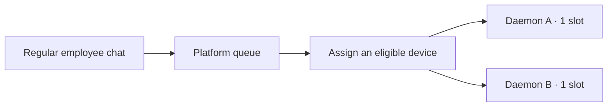

An execution pool groups daemons that you have already paired. Each device identity contributes one slot. If two eligible devices are running turns, a third session can wait for a slot. After the first assignment, follow-ups in that session return to the assigned device and its working directory.

:::note[Availability]
This guide describes the candidate in [Platform PR #1188](https://github.com/WeiJiLab/aiworkforce-platform/pull/1188). The steps require a deployment with that change in both the frontend and backend and the corresponding database migration. For deployments that expose individual devices, see [Session execution location](/deployment/daemon/session-execution/).
:::

## Pair devices and create a pool

1. Pair each daemon with the same Platform account. Open **Personal settings → Device connections** to confirm the devices and their working directories. For prerequisites and browser approval, see [My machines](/deployment/daemon/my-machines/).
2. Under **Execution pools**, use the plus button labeled **Create execution pool**. Enter a name, select at least one device, and use **Save execution pool**. Pool membership is fixed at creation. Members must be your own paired, non-revoked daemons with `device_rpc`. A paired device can be included while offline.
3. Open a new regular chat with a Claude Code employee. Before the first message, choose the named pool in **Execution location** above the composer. The number beside the pool is its configured capacity. The session uses device tools to read files in the paired workspace. Chat attachments are unavailable for this execution location.
4. Send a message. If it waits, the composer shows why. Once assigned, a chat notice names the device and working directory. To change the pool or the workspace for subsequent work, start a new session and choose the new execution location.

A device keeps one slot across all pools and sessions that use it, including sessions that select the device directly. Two pools containing the same device share that slot.

### Connect two daemons

For a local trial, prepare two existing project directories and two separate state paths outside those workspaces. Run each command and approve each pairing in the browser. Replace the example URLs and paths. For a remote host, add `--no-browser` and open the printed authorization link on another device.

```sh
aiworkforce-device-exec connect --workspace /absolute/project/pool-a \
  --platform https://platform.example.org --name pool-a \
  --state-dir /absolute/device-state/pool-a

aiworkforce-device-exec connect --workspace /absolute/project/pool-b \
  --platform https://platform.example.org --name pool-b \
  --state-dir /absolute/device-state/pool-b

aiworkforce-device-exec status --json --state-dir /absolute/device-state/pool-a
aiworkforce-device-exec status --json --state-dir /absolute/device-state/pool-b
```

The state directory stores the device credential and execution journal. Commands run as the daemon's OS user. The paired directory sets the working directory and provides project context. Sessions that land on the same device can encounter files left by previous turns. Two daemons on the same host share the OS and may be affected by the same host failure. Use independently isolated hosts, containers, or VMs when separate failure domains matter. The Kubernetes example covers a single device and its persistent volumes. [Device Executor CLI](/integrations/cli/) · [Device executor on Kubernetes](/deployment/self-host/#run-a-device-executor-on-kubernetes)

## How a turn gets a device



1. **Queue.** Platform writes a turn to PostgreSQL as `queued`. A queued turn has no assigned device of its own, even when the session already has a binding. The coordinator waits up to five minutes for placement. While it waits, the model loop and device commands for that turn have yet to start.
2. **Match.** A candidate must have a valid native connection, be online and authorized for `device_rpc`, and have a free device slot. For each device, Platform compares its oldest eligible bound turn with the oldest unbound turn in that pool, using enqueue time and then Run ID. A follow-up waiting for device A can coexist with an unbound turn that can use device B.
3. **Reserve and execute.** In a database transaction, Platform rechecks eligibility, reserves the slot, records the device binding on first assignment, and advances the turn to `pending`. Platform then runs the Claude Code model loop and sends project tool calls over the daemon's outbound WebSocket connection. The daemon executes them and returns results and stop receipts.
4. **Release and continue.** The slot can serve another session once Platform has finished the turn and accounted for the device's stop. The original session keeps its device binding even while idle. Its next turn waits for that device when necessary, including when another pool member is free.

The browser is the place to choose the target and read progress. Browser closure after submission leaves scheduling and device execution with Platform and the connected daemon. [Pool matching rules](https://github.com/WeiJiLab/aiworkforce-platform/blob/d5f1715b0a3b32e409495de17a9a2cef9817d8bf/backend/domain/local_execution/model/execution_pool.py) · [Reservation transaction](https://github.com/WeiJiLab/aiworkforce-platform/blob/d5f1715b0a3b32e409495de17a9a2cef9817d8bf/backend/infr/repository/local_execution_repository_impl.py) · [Device tool dispatch](https://github.com/WeiJiLab/aiworkforce-platform/blob/d5f1715b0a3b32e409495de17a9a2cef9817d8bf/backend/application/session/device_execution_target.py)

## Read pool capacity and waiting messages

The pool panel shows configured slots, available slots, occupied slots, and unavailable slots. It also shows each device's state, the number of queued turns and, when one is queued, the longest wait.

| Slot count  | Device states                                                                                                                                            |
| ----------- | -------------------------------------------------------------------------------------------------------------------------------------------------------- |
| Available   | Ready.                                                                                                                                                   |
| Occupied    | Busy or stopping. Both reserve capacity until the active turn clears.                                                                                    |
| Unavailable | Offline, isolated, revoked, unsupported, or otherwise unavailable. An isolated device may have reconnected while its last execution is still unresolved. |

The chat message reflects the devices eligible for that session.

| Chat wait reason                        | What to check                                                                                                    |
| --------------------------------------- | ---------------------------------------------------------------------------------------------------------------- |
| Waiting for a pool device assignment    | An eligible slot is ready. Wait for the coordinator to assign it in queue order.                                 |
| Pool devices are running or stopping    | Eligible devices are occupied. A queued turn can proceed after an eligible slot is released.                     |
| No pool device is currently schedulable | Check each device in **Execution pools** for connectivity, authorization, client support, or isolation.          |
| Waiting for the bound device            | Check the named device and its state. Follow-ups stay on that device even if the pool has other available slots. |

## Cancel or recover a turn

- **Cancel before assignment.** The queued turn ends with zero device commands if cancellation commits first. If assignment and cancellation race, follow the recorded turn state. Work that had already acquired a device lease must complete the stop protocol.
- **Wait timed out.** The turn is marked interrupted. After checking pool and device status, send a new message in the same session. A session with an existing binding continues to use that device.
- **Device disconnected during execution.** The affected turn is interrupted. Other workers hold their own leases and can continue if they remain healthy and can confirm their stops. If the worker stopped, start it again with its original state directory, for example `aiworkforce-device-exec start --state-dir /absolute/device-state/pool-a`. After the slot is ready, send a new message from the same session. The old turn remains interrupted and its commands are never automatically replayed onto another device. If the outcome of a command is unknown, check the project and its receipts before asking to run it again.
- **Stop unconfirmed or device isolated.** Check `status --json`, `doctor --json`, and the read-only `stop-review --json` using the affected daemon's `--state-dir`. Retain the execution journal. A browser cancellation, reconnect, or expired Platform lease cannot substitute for a stop receipt or supported recovery evidence. [Troubleshoot self-hosted machines](/deployment/daemon/troubleshooting/)
- **Platform coordinator restarted.** Lease expiry and reconciliation settle the abandoned turn as interrupted. PostgreSQL notifications wake chat reconciliation after the terminal status is committed, with periodic reconciliation covering missed notifications. The chat can become ready for a new message while the device slot still needs stop confirmation. [Session reconciliation](https://github.com/WeiJiLab/aiworkforce-platform/blob/d5f1715b0a3b32e409495de17a9a2cef9817d8bf/backend/application/session/session_reconciliation_service.py)

## Deploy and inspect the candidate

Use a candidate frontend and backend from the same Platform revision. Keep the existing device pairing and outbound WSS route `/api/daemon/v2/connect`, PostgreSQL, and the Claude Code channel. From the candidate's `backend` directory, apply the expand migration using the deployment's current database configuration, then verify the schema before starting the matching services.

```sh
python -m scripts.run_migrations --phase expand
python -m scripts.verify_schema_contract
```

Migration `20270101_execution_pools` adds the pool table and permits pool sessions and queued runs to have no assigned device yet. Its downgrade guards against dropping pool records or bindings and queued runs. [Migration source](https://github.com/WeiJiLab/aiworkforce-platform/blob/d5f1715b0a3b32e409495de17a9a2cef9817d8bf/backend/infr/repository/migrations/versions/20270101_execution_pools.py)

These candidate endpoints use the signed-in Platform account.

| Endpoint                                             | Request or result                                                                                                                                       |
| ---------------------------------------------------- | ------------------------------------------------------------------------------------------------------------------------------------------------------- |
| `POST /api/local-execution/pools`                    | Send `name` (1–120 characters after trimming) and `machine_ids` (1–100 distinct device UUIDs).                                                          |
| `GET /api/local-execution/pools`                     | Lists your pools under `data.pools`, including `capacity`, `workers`, `queued_count`, and `oldest_queued_at`.                                           |
| `PUT /api/sessions/{session_id}/execution-device`    | Set `pool_id` on your regular session before it starts. Device selection uses `machine_id`. Supply at most one non-null target.                         |
| `GET /api/sessions/{session_id}/execution-pool-wait` | Reads the current wait for your pool session. If it is queued, `data.wait` contains `reason`, `queued_at`, and the bound device status when applicable. |

[Pool routes](https://github.com/WeiJiLab/aiworkforce-platform/blob/d5f1715b0a3b32e409495de17a9a2cef9817d8bf/backend/ohs/http/local_execution_router.py) · [Session routes](https://github.com/WeiJiLab/aiworkforce-platform/blob/d5f1715b0a3b32e409495de17a9a2cef9817d8bf/backend/ohs/http/session_router.py)

## How Cursor Team Pools handle worker capacity

Cursor Team Pools target Enterprise infrastructure managed by a team. Cursor hosts the Agent loop, model access, and routing. Workers execute tool calls in the team's environment. An administrator enables Self-Hosted Machines and provisions a service account. In claim-then-spawn mode the controller can issue a per-claim session token so the long-lived key can stay on the controller. [Cursor Team Pools](https://cursor.com/docs/cloud-agent/self-hosted/pool) · [Session tokens](https://cursor.com/docs/cloud-agent/self-hosted/pool#session-tokens)

| Dimension               | AI Workforce fixed-capacity pool                                                           | Cursor Team Pools                                                                                                                                                                      |
| ----------------------- | ------------------------------------------------------------------------------------------ | -------------------------------------------------------------------------------------------------------------------------------------------------------------------------------------- |
| Routing                 | The session owner selects one personal pool of paired device identities.                   | Requests target named team pools. Repo-backed pools match repository and pool labels. Any-repo pools match the pool name and can optionally check out requested repositories on claim. |
| Capacity                | Previously paired, available daemons provide the configured slots.                         | Workers can stay connected. The CLI controller can also claim pending requests and call a spawn hook, or use `--warm-idle` to maintain idle workers for Cursor to assign.              |
| Slot lifetime           | One turn uses a device until its stop is accounted for. The session binding persists.      | One worker process serves one Cloud Agent, including between turns until its idle release window ends. The default is one hour.                                                        |
| Follow-up after release | Follow-ups wait for the original device and workspace.                                     | A released session can reacquire capacity. With hibernation and a reconnect window, an operator can restore the original workspace from a snapshot.                                    |
| Observation             | Pool settings show slots and queue age. Chat shows the wait reason for a specific session. | Pool APIs expose connected and in-use counts. Pending-request lists and an SSE stream inform external controllers.                                                                     |

[Cursor any-repo pools](https://cursor.com/docs/cloud-agent/self-hosted/pool#any-repo-pools) · [Worker controller](https://cursor.com/docs/cloud-agent/self-hosted/pool#worker-controller) · [Session lifecycle](https://cursor.com/docs/cloud-agent/self-hosted/pool#session-lifecycle) · [Hibernation](https://cursor.com/docs/cloud-agent/self-hosted/pool#hibernation) · [Cursor Kubernetes example](https://github.com/anysphere/k8s-workers)

## Verify two slots with three sessions

Use an isolated Platform deployment and PostgreSQL database, two independently paired daemons with distinct workspaces, and a regular account in the browser. Give each test turn a unique marker and record the device, working directory, and tool receipts. Have the test command append its marker so a duplicate execution is visible.

| Exercise                                                                                                    | Observe                                                                                                                                                  |
| ----------------------------------------------------------------------------------------------------------- | -------------------------------------------------------------------------------------------------------------------------------------------------------- |
| Keep two sessions running, one per device. Submit the first turn in a third session.                        | Two slots are occupied. The third turn waits without a device command receipt.                                                                           |
| Cancel the third turn while it is still queued and send a new request in that session.                      | The cancelled marker appears on neither device. A new turn enters the queue.                                                                             |
| Disconnect the first daemon while the second is working.                                                    | The first turn is interrupted. The second can finish. After its stop is confirmed, the third session can use that device's slot.                         |
| Reconnect the first daemon with its original state directory, then send a new message to the first session. | The follow-up uses the original device and working directory. The old turn stays interrupted, and its marker appears at most once.                       |
| Restart the Platform coordinator with a turn outstanding.                                                   | The abandoned Run is reconciled after its lease expires, including if a notification was missed. Reconcile device stop evidence before reusing the slot. |

To run the candidate’s targeted repository tests, use the deployment’s Python dependencies and an isolated PostgreSQL database. Set the existing `AIWORKFORCE_TEST_DATABASE_URL` to a disposable database that permits temporary schema creation. Without it, the PostgreSQL race tests are skipped. From `backend`, run the following.

```sh
python -m pytest -q tests/test_native_daemon_acceptance.py \
  tests/test_native_execution.py tests/test_local_execution_domain.py \
  tests/test_session_startup_reconciliation.py
```

The investigation exercised real Platform, PostgreSQL, browser sessions, and daemon tool calls in a local deployment with a deterministic model substitute. It also reproduced a same-host macOS case where a worker's stop could not be confirmed and the queue did not advance. Repeat the isolation exercise on the daemon version and deployment topology you intend to operate. The Cursor investigation checked the installed CLI's worker and controller help. The Enterprise routing and lifecycle descriptions above come from Cursor's published documentation. [Platform candidate and verification history](https://github.com/WeiJiLab/aiworkforce-platform/pull/1188)
