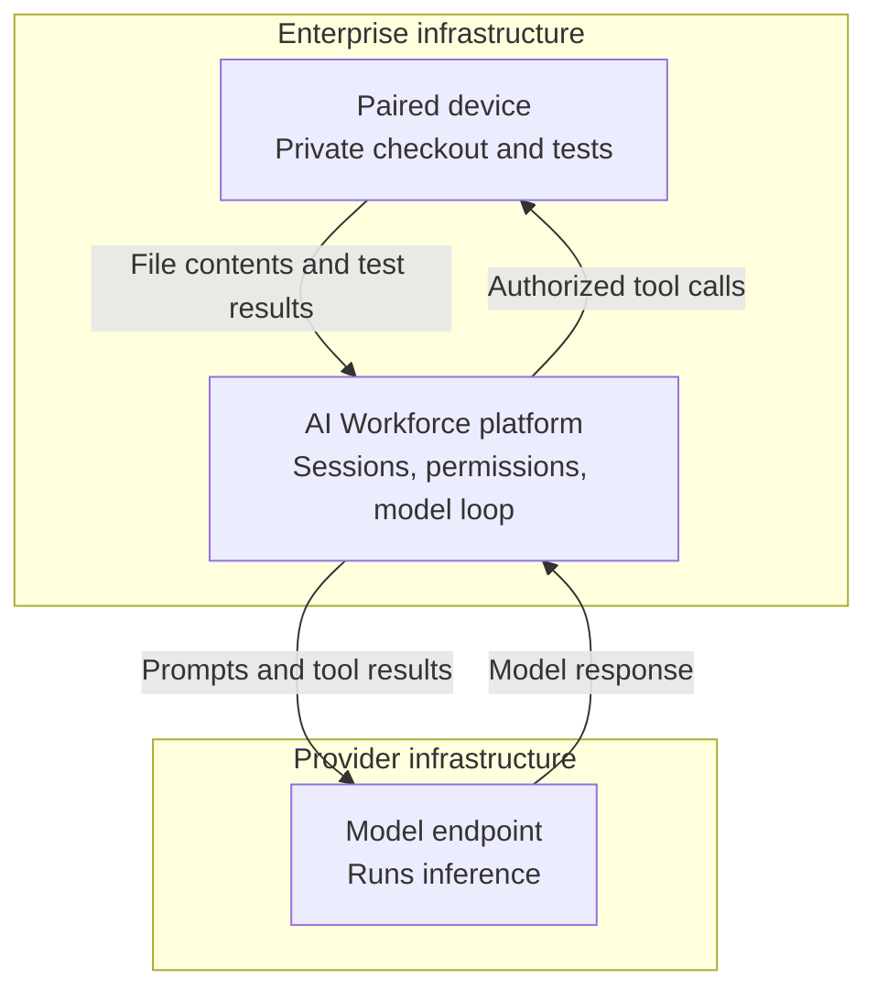

Assign a private repository fix to a digital employee and have it verify the change on a machine that can reach your internal test service. Your team chooses the repository the employee can access, the execution device, and the model endpoint. AI Workforce manages the session, checks tool permissions, and records the work for review.

## Where does a private repository test run?

This example uses a self-hosted platform, a paired development machine, and an external model provider. The arrows show where task data flows. The device opens the connection to the platform and uses it to receive commands and return results.

## Choose what your organization operates

**Keep custody of session records.** Run the platform on a host your organization operates. The backend calls the model, PostgreSQL stores session and automation state, and persistent volumes hold workspace files. Your team handles upgrades, backups, and recovery. You can also use an operator-hosted platform and have the operator maintain these services. [Self-host the platform](/deployment/self-host/)

**Run tests on a specific device.** Select an online, paired device before the first session message. Tools run with the device user's OS permissions. The paired directory sets the starting location and the OS account determines file access. Choose platform execution when the task only needs resources already connected to the platform. [Choose a session execution location](/deployment/daemon/session-execution/)

**Keep inference inside your network.** Configure the employee's runtime to use a model endpoint that performs inference inside your network. With the external endpoint shown above, prompts, file contents read for the task, and tool results used in a model call reach the provider even when your organization hosts both the checkout and the session database. [Configure a model channel](/administration/configuration/)

## How does the team accept the fix?

A reviewer checks the commands and test output in the employee session, then opens the delivery card to compare the tested revision with the revision proposed for merge. Once the revisions match and the change meets the acceptance criteria, the team decides whether to merge. [Follow an issue to a pull request](/recipes/issue-to-pr/)
