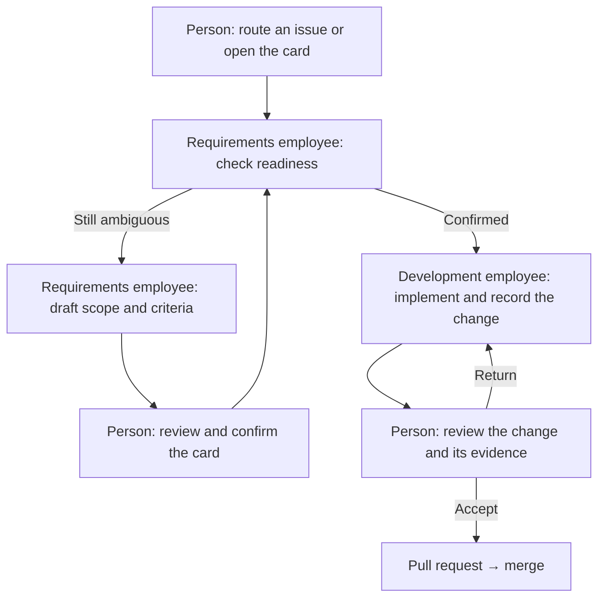

This loop starts from a card the team has accepted, or from an inbox issue you route onto the board. The requirements employee checks the problem, the outcome, the scope, and the target repositories. An ambiguous card stays in clarification until you confirm it. A bounded card proceeds to Development. The development employee implements the change, runs the checks it is configured to run, and records a pull request, branch, or commit on the card.

People are marked in the diagram. Employees run the other steps.

You can also open a development session for a task that is already specific. If the session needs a scope decision, the card waits for your confirmation before the change proceeds. A passing check does not record your acceptance.

The worked example is [Issue to PR](/recipes/issue-to-pr/). The click path on an existing board is the [quickstart](/getting-started/quickstart/).

## Where you participate

- **Provide scope.** Name the expected behavior, the acceptance criteria, the constraints, and the repositories the change may touch.
- **Confirm a drafted specification.** Resolve open product questions and confirm what should be built. [Requirements → card](/software-factory/requirements-to-card/) is that review when the brief is still large.
- **Review the change.** Read the diff, the test results, and the gaps the employee reported. Record the decision on the card. Return a failed criterion with the evidence that shows it.

During the session, answer questions and approval requests on the card. Taking over stops automatic progress. Hand the work back explicitly. A shared batch can include other cards, so read its members before a batch operation.

## Lane employees

| Employee              | Role in this loop                                                                                                                          |
| --------------------- | ------------------------------------------------------------------------------------------------------------------------------------------ |
| Requirements employee | Checks readiness, drafts missing scope, and keeps the card in Requirements until you confirm it.                                           |
| Development employee  | Implements, runs configured checks, and records the code reference. Repairs the card when you return it.                                   |
| Test employee         | Records verification for the candidate when the board runs Testing (测试验证). See [Pull request → merge](/software-factory/pr-to-merge/). |

The development employee needs a repository grant that covers the actions you expect, including branch and pull request creation when the path should open a pull request. The polling token used by a GitHub trigger does not grant those actions.

## Set it up

1. Connect the code host and grant the development employee the repository. Follow [Configure the Software Factory](/getting-started/first-software-factory/) and [code repositories](/integrations/code-repositories/).
2. Assign ready employees to Requirements and Development. In **Lane configuration**, check each lane's **Execution identity**.
3. Route a ready inbox issue to the project, or confirm a card that a requirements session already drafted.
4. Open the card from **Workbench** (工作台). The delivery workbench is at `/automations?tab=board-flow`. Follow **Executions** to the session and **Deliverables** to the code reference.

## Next step

Continue with [Pull request → merge](/software-factory/pr-to-merge/) for verification, repair, and the release decision. [Review and release](/software-factory/review-release/) is the checklist for each recorded stage.
