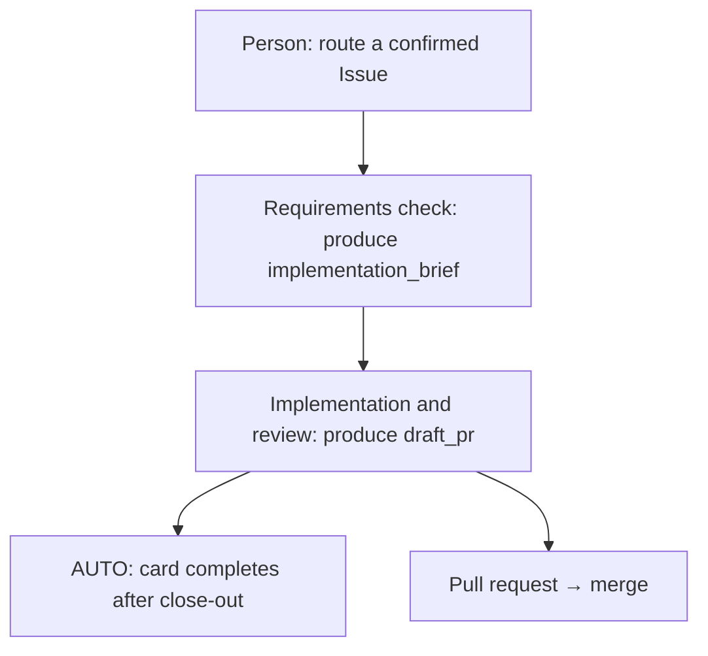

The `pr-author` template turns a confirmed Issue into a reviewable code reference. Its first stage, Requirements check, produces `implementation_brief` with the approved scope, acceptance conditions, target repository, and authorization. Its second stage, Implementation and review, reads that brief, implements the change, runs relevant checks, and produces `draft_pr` with the link, commit, and check results.

The template uses `AUTO`, so a final `READY` result can complete the card after close-out. Merge and production release remain separate board or repository decisions.

Open the development session from the card after the lane dispatches it. If the session needs a scope decision, the card waits for your confirmation before the change proceeds. A passing check does not record your acceptance.

The worked example is [Issue to PR](/recipes/issue-to-pr/). The click path on an existing board is the [quickstart](/getting-started/quickstart/). For the complete scenario catalog, see [Collaboration templates](/software-factory/templates/).

## Where you participate

- **Provide scope.** Name the expected behavior, the acceptance criteria, the constraints, and the repositories the change may touch.
- **Confirm a drafted specification.** Resolve open product questions and confirm what should be built. [Requirements → card](/software-factory/requirements-to-card/) is that review when the brief is still large.
- **Review the change.** Read the diff, the test results, and the gaps the employee reported. Record the decision on the card. Return a failed criterion with the evidence that shows it.

During the session, answer questions and approval requests on the card. Taking over stops automatic progress. Hand the work back explicitly. A shared batch can include other cards, so read its members before a batch operation.

## Handoff contract

| Stage                     | Input                                               | Output                                                                       |
| ------------------------- | --------------------------------------------------- | ---------------------------------------------------------------------------- |
| Requirements check        | The confirmed Issue and its authorization           | `implementation_brief` with scope, criteria, repository, and access boundary |
| Implementation and review | `implementation_brief` and the permitted repository | `draft_pr` with the PR or branch, exact commit, and check results            |

The implementation stage receives the first stage's artifact through the template's `requires` mapping. A repository grant must cover the branch and pull request actions that the stage is expected to perform. A polling token used by a GitHub trigger does not grant those actions.

## Set it up

1. Choose the published `pr-author` template in **Workbench → New delivery project**. See [Collaboration templates](/software-factory/templates/) for the scenario catalog.
2. Connect the code host and grant the implementation stage the repository. Follow [Configure the Software Factory](/getting-started/first-software-factory/) and [code repositories](/integrations/code-repositories/).
3. Bind ready employees to Requirements check and Implementation and review. In **Lane configuration**, check each stage's **Execution identity**.
4. Route a ready inbox issue to the project, or open a confirmed card. Follow **Executions** to the stage results and **Deliverables** to the `draft_pr` artifact.

## Next step

Continue with [Pull request → merge](/software-factory/pr-to-merge/) for verification, repair, and the release decision. [Review and release](/software-factory/review-release/) is the checklist for each recorded stage.
