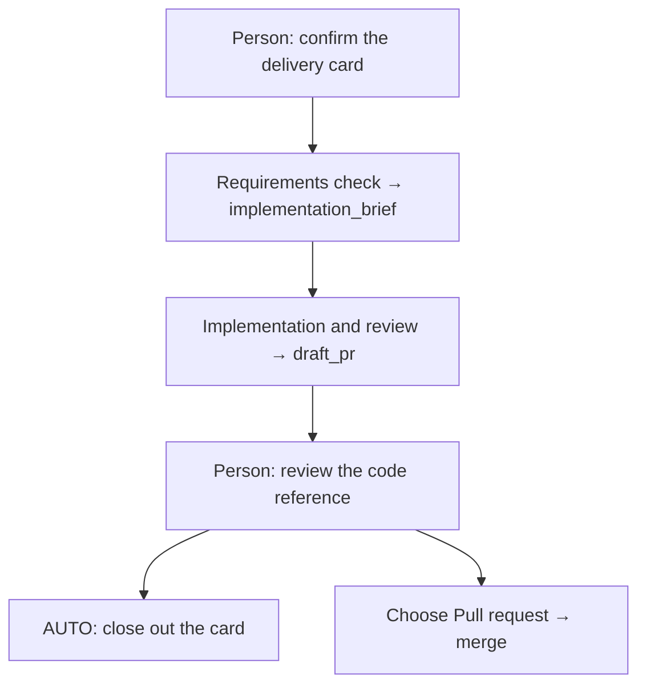

Use the published `pr-author` collaboration template when a card has a confirmed scope and is ready for implementation. The template records the authorization and implementation boundary before an employee changes a repository.

Requirements check produces `implementation_brief` with the approved scope, acceptance conditions, target repository, and authorization. Implementation and review reads that artifact, implements the change, runs the relevant checks, and produces `draft_pr` with the pull request or branch, exact commit, and check results.



## Template contract

| Stage                     | Reads                                               | Produces                                                                     | Person's decision                                          |
| ------------------------- | --------------------------------------------------- | ---------------------------------------------------------------------------- | ---------------------------------------------------------- |
| Requirements check        | The confirmed card and its authorization            | `implementation_brief` with scope, criteria, repository, and access boundary | Confirm what the implementation may change                 |
| Implementation and review | `implementation_brief` and the permitted repository | `draft_pr` with the code reference, exact commit, and check results          | Review the change and return failed criteria with evidence |

The implementation stage receives `implementation_brief` through the template's `requires` mapping. A repository grant must cover the branch and pull request actions that the stage is expected to perform. A polling token used by an issue trigger does not grant those actions.

## Configure the template

1. Open **Workbench → New delivery project** and choose `pr-author` from the published collaboration templates.
2. Connect the code host and grant the implementation stage access to the target repository. Check the stage's execution identity.
3. Bind ready employees to Requirements check and Implementation and review.
4. Route a ready inbox issue into the project, or create a confirmed card in the first stage.
5. Follow the execution record and inspect `implementation_brief` and `draft_pr` before continuing to review.

The template uses `AUTO`, so the card can complete after the final stage returns `READY` and close-out finishes. Merge and production release remain separate decisions.

## Template for a development handoff

The development employee fills this in when the change is ready for review. Record it on the card and link the PR so the reviewer can open the diff and reproduce the checks.

```text
Card and scope — [card reference] [confirmed acceptance criteria]
Change — [repository, what changed, why]
Code to review — [PR if opened, otherwise branch] [exact commit]
Checks — [acceptance criterion → check run → result and evidence]
Gaps or review request — [what was not verified] [what the reviewer should decide]
```

**Example.** For C-17, the CSV query now uses the order list’s filter. The developer records PR #58 and its head commit on the card. The test run on that commit passes both cases. One matching order produces one data row, and no matches produce the header only. Link the test run and ask the reviewer to check the downloadable file in the test environment.

## Continue with the next template

Use [Pull request → merge](/software-factory/pr-to-merge/) to choose the evidence template for review, repair, verification, and release. The [Issue to PR](/recipes/issue-to-pr/) recipe shows one complete path from intake to a draft Pull Request.
