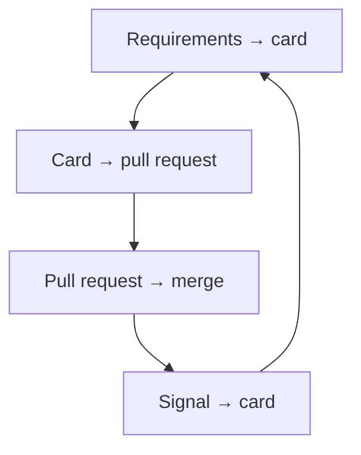

Asking an employee for a new prompt at every handoff leaves people coordinating the software lifecycle. Software Factory connects the delivery board's lanes into four loops, so a confirmed card moves through implementation, verification, and release without a fresh prompt in every column. People stay on the judgment calls: scope, the review of evidence, and whether the change ships.

The product surface is the **delivery workbench**. Open **Workbench** (工作台) in the primary navigation. The address is `/automations?tab=board-flow`. It uses the same workflow, automation, employees, and evidence as the [Kanban workbench](/workflows/kanban-workbench/) and [issue automation](/workflows/issue-automation/).

## The full flow

Lane employees carry a requirement to a reviewed change. A connected pipeline deploys the merged revision. Feedback and incidents become the next card when someone confirms the follow-up.



A **card** is the work item these loops hand off. An imported GitHub, GitLab, Yunxiao, Jira, or Linear issue becomes that card when you route it to a project and confirm it. The card keeps the confirmed scope, the session, the code reference, the test record, and the human decision.

## Four loops

| Loop                 | What moves forward                                                                                 | Guide                                                             |
| -------------------- | -------------------------------------------------------------------------------------------------- | ----------------------------------------------------------------- |
| Requirements → card  | A feature brief becomes a reviewed scope and a confirmed card.                                     | [Requirements to a card](/software-factory/requirements-to-card/) |
| Card → pull request  | A confirmed card becomes an implemented change with a pull request, branch, or commit on the card. | [Card to a pull request](/software-factory/card-to-pr/)           |
| Pull request → merge | A reviewed change is repaired, verified, and presented for a person's merge and release decision.  | [Pull request to merge](/software-factory/pr-to-merge/)           |
| Signal → card        | Feedback or an incident is investigated, and a person decides which follow-up becomes a card.      | [Signal to a card](/software-factory/signal-to-card/)             |

Each guide names the lane employees, the points where a person decides, and the setup for that loop.

## Where to start

Start with the loop that limits throughput. Configure that loop first.

| What is slowing the team down                       | Start here                                                                                             |
| --------------------------------------------------- | ------------------------------------------------------------------------------------------------------ |
| The request is still a brief                        | [Requirements → card](/software-factory/requirements-to-card/)                                         |
| A clear issue is waiting for code                   | [Card → pull request](/software-factory/card-to-pr/) or the [quickstart](/getting-started/quickstart/) |
| Changes sit in review or release                    | [Pull request → merge](/software-factory/pr-to-merge/)                                                 |
| Reports never become work                           | [Signal → card](/software-factory/signal-to-card/)                                                     |
| The board, repositories, or employees are not ready | [Configure the Software Factory](/getting-started/first-software-factory/)                             |

## How the loops sit on the board

Built-in lanes, in order:

```text
Requirements (需求) → Development (开发) → Test deployment (测试发布) → Testing (测试验证) → Production (生产发布) → Done (已完成)
```

| Loop                 | What carries it on the board                                                                                                                        |
| -------------------- | --------------------------------------------------------------------------------------------------------------------------------------------------- |
| Requirements → card  | The Requirements lane. A person confirms scope, acceptance criteria, and the repositories the change may touch.                                     |
| Card → pull request  | The Development lane. The lane employee works in a session and records a pull request, branch, or commit.                                           |
| Pull request → merge | Test deployment (测试发布), Testing (测试验证), and Production (生产发布). Merge and production run when the repository and pipeline are connected. |
| Signal → card        | The inbox and a collection Job. A confirmed follow-up enters Requirements.                                                                          |

A step inside a lane is execution state. Custom boards can arrange lanes differently. There is no WIP limit. Cards that will be tested together can share a batch. Closing a batch finishes that batch's close-out. Production release has its own record.

## People keep the decisions

Confirming a draft lets the development lane proceed. That confirmation leaves repository credentials and pipeline setup where they already are: on the workspace and the project. During a run, answer questions on the card. Taking over stops automatic progress and keeps the current state. Hand the work back explicitly. Resuming a pause leaves a takeover in place. An operation on a shared batch can affect every member card.

The records around a decision are [evidence](/software-factory/evidence/), [quality gates](/software-factory/quality-gates/), and [release governance](/software-factory/release-governance/).

## Related guides

- [Issue automation](/workflows/issue-automation/) collects or polls issues before they become cards.
- [Kanban workbench](/workflows/kanban-workbench/) is this board, read as lanes, cards, and batches.
- [Pull request automation](/workflows/pull-request-automation/) starts a Job from a polled GitHub pull request event.
- [Issue to PR](/recipes/issue-to-pr/) walks one example from the inbox to a review decision.
