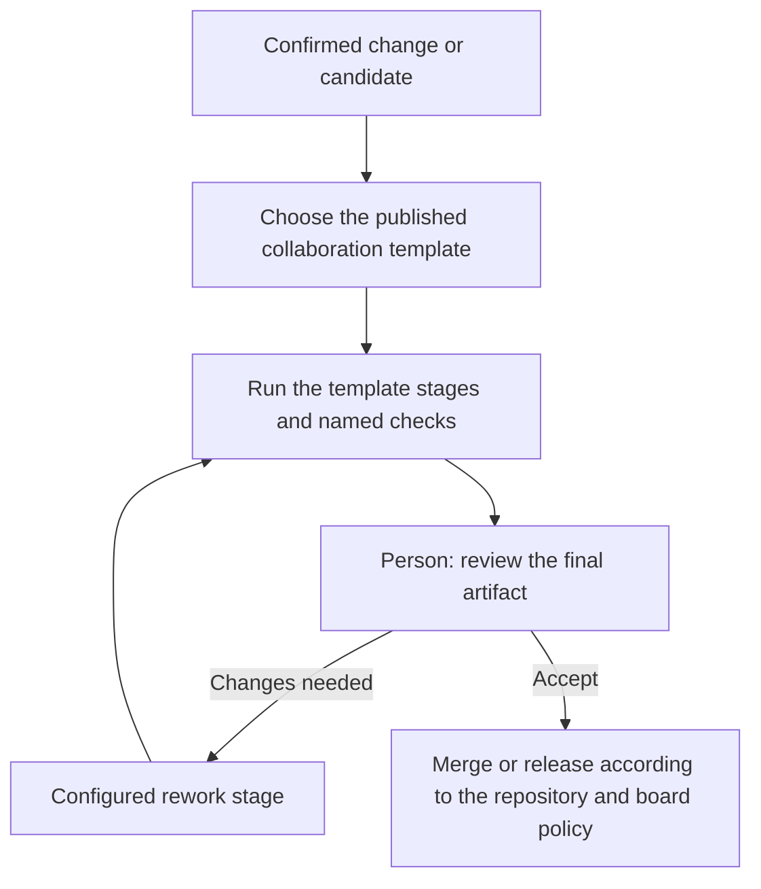

A Pull Request does not determine its own delivery workflow. Choose a published collaboration template based on the evidence and decision the card needs. The selected template defines the stages, named artifacts, rework path, and completion rule.

Use `pr-spec-adherence-check` for a focused specification check. Use `customer-escalation-to-product-fix` when a customer report requires reproduction, a fix, verification, and a reply draft. Use `release-candidate-readiness-review` when a candidate release needs an evidence-based readiness decision.



## Choose the evidence template

| Template                             | Use it when                                                               | Key handoff artifacts                                            | Completion     |
| ------------------------------------ | ------------------------------------------------------------------------- | ---------------------------------------------------------------- | -------------- |
| `pr-spec-adherence-check`            | A Pull Request needs a traceable check against its specification          | `acceptance_criteria` → `adherence_report`                       | `AUTO`         |
| `customer-escalation-to-product-fix` | A customer report needs a reproducible fix, verification, and reply draft | `reproduction` → `pull_request` → `verification` → `reply_draft` | `HUMAN_REVIEW` |
| `release-candidate-readiness-review` | A candidate release needs an evidence-based go or no-go decision          | `candidate_evidence` → `readiness_report`                        | `HUMAN_REVIEW` |

Read the tested revision, source links, failed cases, and decision owner from the named artifact. A free-form status comment does not replace the template handoff contract.

## Where the board participates

The built-in board can carry evidence through Test deployment, Testing, and Production release. A custom board can arrange the selected template's stages differently. Test employees record results for the candidate that was actually exercised. Pull Request automation can start a Job when a matching event arrives, while the selected collaboration template remains responsible for the card's delivery stages.

A failed check or a review asking for changes should use the configured rework path. Return the card with the failed criterion and its evidence. Production deployment and resource cleanup have their own records. See [Review and release](/software-factory/review-release/) and [Release governance](/software-factory/release-governance/) for the decisions around the final artifact.

## Configure the template

1. Open **Workbench → New delivery project** and choose the evidence template that matches the decision.
2. Connect the repository, test workflow, and release integration required by the selected stages.
3. Bind ready employees to every required stage and check each execution identity.
4. Open the run and inspect the named artifacts for the tested revision, environment, failed cases, and reviewer.
5. Accept the final artifact, or send the card through the configured rework path with the missing evidence.

The template completion rule controls the card's close-out. It does not merge a Pull Request or approve a production release unless the configured stage is explicitly authorized to perform that action.

## Template for a merge decision

Use this when a candidate has been built for a batch. Record the test result on each card. Before acting on the batch, check its members and the candidate revision the evidence covers.

```text
Batch under review — [batch, member cards and PRs] [candidate commit per repository]
Verification — [card and criterion → environment, tested revision, result, evidence]
Decision — [ready to merge / return for repair / waiting] [reason and affected cards]
Approval — [decision record if the batch policy requires approval]
Merge outcome — [actual merge commit or pending]
Production outcome — [deployed revision and run evidence, or pending / not configured]
```

**Example.** Batch B-9 contains C-17 and PR #58. The tester downloads both CSV samples from the candidate and attaches them to C-17. If the empty result still contains orders, return C-17 with the failing sample and retest the repaired candidate. If both checks pass and the batch is approved as required, record the resulting merge commit. Leave production pending until the deployment run identifies the deployed revision.

## Continue with the next template

When a new report or incident should become work, use [Signal → card](/software-factory/signal-to-card/) to collect evidence and choose the right collaboration template. For the complete scenario catalog, see [Collaboration templates](/software-factory/templates/).
