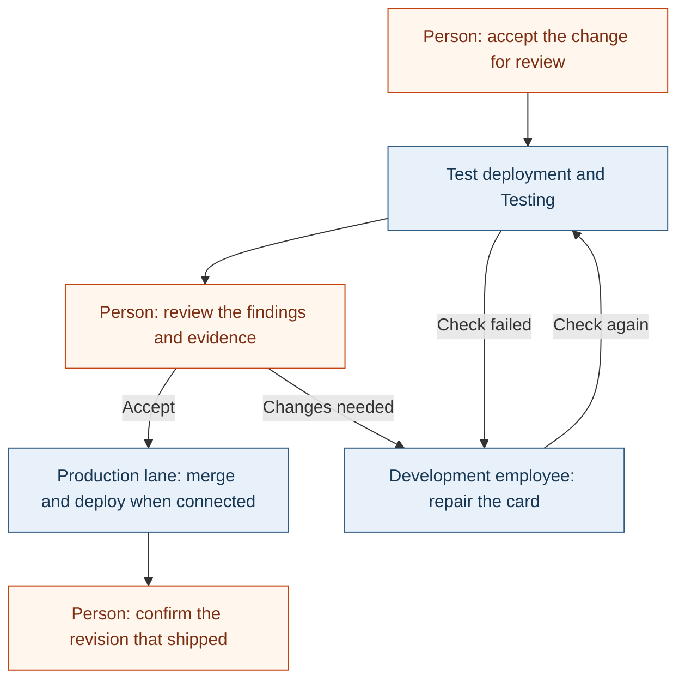

After development records a change, the card moves through Test deployment (测试发布) and Testing (测试验证). You read the findings and the evidence. A failed check, or a review that asks for changes, sends the card back to the development employee. When you accept the change, the Production (生产发布) lane merges and deploys only where the project has a working repository and pipeline integration. You decide that the revision is the one to ship.

People are marked in the diagram. Employees and lane checks run the other steps.

Test deployment and Testing are board lanes, not a sequence of separate reviewer products. The test employee records results for the candidate that was actually exercised. [Pull request automation](/workflows/pull-request-automation/) can also start a Job when a polled GitHub pull request event matches. That Job investigates. It does not merge, and it does not approve the pull request unless the employee, using its own grant, actually submitted a review.

A closed batch means the batch finished its close-out. Production and resource cleanup have their own records. [Review and release](/software-factory/review-release/) lists what to read at each stage. [Release governance](/software-factory/release-governance/) is the rule for which result may move a card, and which waiver is valid.

## Where you participate

- **Choose what the lanes may do.** Connect the test workflow and the release integration you want the board to call. A lane runs the executors saved on that lane.
- **Review the evidence.** Compare the diff with the confirmed scope. For each acceptance criterion, read the result, the tested commit or candidate, and the environment. Ask for the missing record before accepting the change.
- **Make the release decision.** Accepting the requirements confirms that revision of the requirement. Accepting the change for review is a later decision. Confirming what merged, and what reached production, are later records still. An employee session does not merge the pull request by being finished.

When a test fails, return the card with the failed criterion and the evidence. The development employee repairs that card. Avoid a second repair session while the first execution is still active. If you take over, record what you did and hand the work back through the recovery action. Resuming a pause leaves a takeover in place. Ending the platform's pull-request follow-up leaves the external pull request open and the card in manual handling until you hand it back.

A batch-level response can resume every member card. Read the membership before you approve or retry shared work.

## Lane employees

| Employee             | Role in this loop                                                                               |
| -------------------- | ----------------------------------------------------------------------------------------------- |
| Test employee        | Records verification against the candidate in the Testing batch.                                |
| Development employee | Repairs the same card when a check fails or you ask for changes.                                |
| Release employee     | Carries merge, wait, deploy, and verify steps that the project's integrations actually support. |

[Business verification](/software-factory/business-verification/) is the comparison between the change and the confirmed acceptance criteria. [Build and test](/software-factory/build-test/) is the Testing-lane record. [CI/CD integration](/software-factory/cicd/) is how a pipeline becomes that record.

## Set it up

1. Connect the code host and the repository. Prepare the [environment](/software-factory/environments/) and the test tools the Testing lane should run. [Configure the Software Factory](/getting-started/first-software-factory/) covers the board wizard.
2. Assign the test and release employees the template marks as required. Authorize them for the repositories and pipeline resources those lanes call.
3. Open a card whose development lane has recorded a code reference, or mark that change ready for Test deployment. Read the delivery workbench, the pipeline run, and any question waiting on the card.

## Next step

Continue with [Signal → card](/software-factory/signal-to-card/) when feedback or an incident should become the next piece of work. [Evidence and trace](/software-factory/evidence/) is the map of the records this loop leaves behind.
