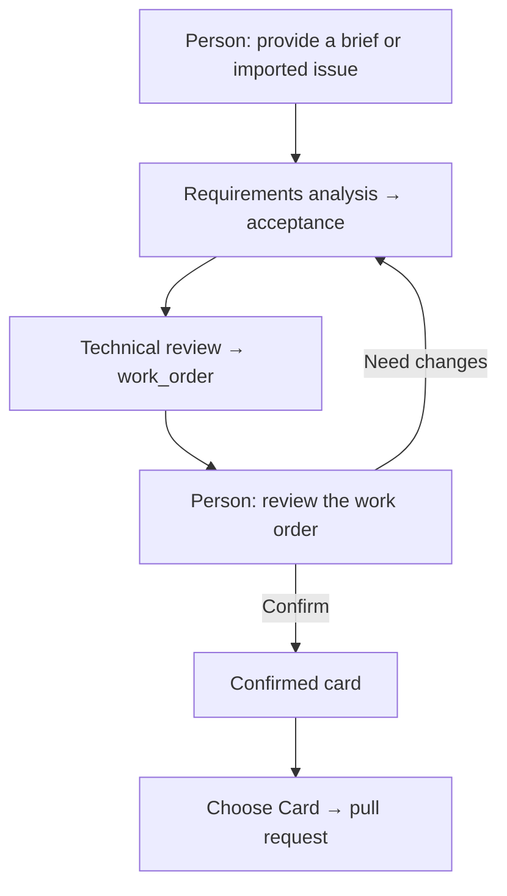

Use the published `spec-intake-to-rfc-ticket-breakdown` collaboration template when work starts as a brief, an imported issue, or a rough note. The template turns the request into named artifacts that a person can review before development begins.

The template has two stages. Requirements analysis produces `acceptance` with the goal, scope, acceptance criteria, and open questions. Technical review reads that artifact and produces `work_order` with implementation constraints, verification methods, risks, and unresolved decisions. The template ends with `HUMAN_REVIEW`, so a person confirms the development-ready card.



## Template contract

| Stage                 | Reads                                              | Produces                                                                                     | Person's decision                                        |
| --------------------- | -------------------------------------------------- | -------------------------------------------------------------------------------------------- | -------------------------------------------------------- |
| Requirements analysis | The brief, issue, or note                          | `acceptance` with goal, scope, criteria, and open questions                                  | Provide missing context and clarify the intended outcome |
| Technical review      | `acceptance` and the authorized repository context | `work_order` with implementation scope, verification method, risks, and unresolved questions | Confirm that the work is ready for development           |

The technical stage receives `acceptance` through the template's `requires` mapping. Keep repository and environment limits in the card so both stages use the same boundary. Split a large brief into separate cards when each part needs its own acceptance decision.

## Configure the template

1. Open **Workbench → New delivery project** and choose `spec-intake-to-rfc-ticket-breakdown` from the published collaboration templates.
2. Bind ready employees to Requirements analysis and Technical review. Check each stage's execution identity and grant only the access it needs.
3. Create a card in the first stage, or route a collected inbox item into the project. Include the source, intended outcome, constraints, and repository scope.
4. Read `acceptance` and `work_order`, answer open questions on the card, and record the human review decision.

Leave the card in the current stage while an acceptance criterion or technical constraint is ambiguous. See [Human approval](/user-guide/human-approval/) and [Work intake](/software-factory/intake/) for the surrounding review and intake behavior.

## Template for a requirements card

Start this in the requirements session. Put the agreed scope and checks on the card so the developer can tell when the work is complete.

```text
Problem and source — [who encounters it, when, and which report or brief describes it]
Outcome — [what the user should observe]
Scope — [target repositories and behavior included] [out of scope]
Acceptance — [given …, when …, then … (one observable result per case)]
Open decision — [question and decision owner] [answer once resolved]
Handoff — [card reference] [scope review if required by the board]
```

**Example.** For Issue #42, limit the change to order CSV export in the orders repository. With one of three orders matching the filter, the CSV must contain only that order. The product owner specifies that an empty result must export the header with zero data rows. Put both cases on card C-17 and leave PDF export out of scope.

## Continue with the next template

After the card is confirmed, choose [Card → pull request](/software-factory/card-to-pr/) and run the published `pr-author` template. If the request came from feedback or an incident, start with [Signal → card](/software-factory/signal-to-card/) and choose the scenario after intake.
