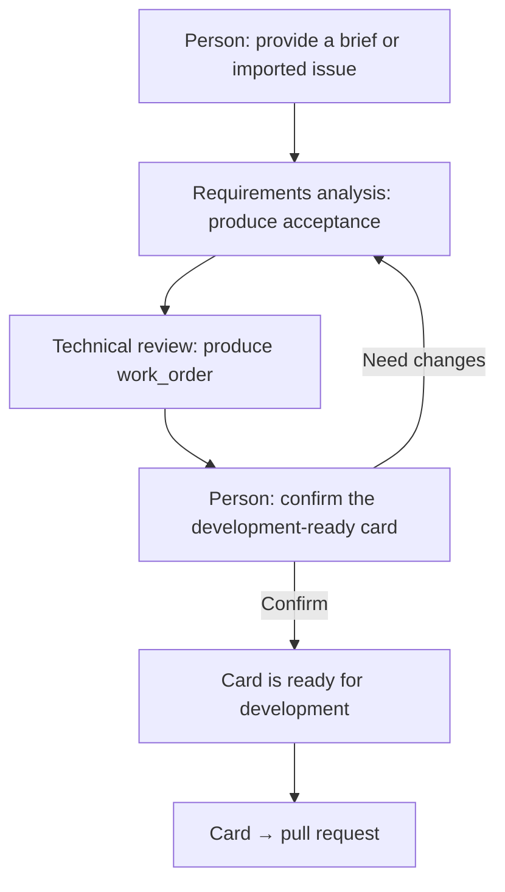

The `spec-intake-to-rfc-ticket-breakdown` template turns a brief, an imported issue, or a rough note into a development-ready card. Its first stage, Requirements analysis, produces the `acceptance` artifact with the goal, scope, acceptance criteria, and open questions. Its second stage, Technical review, reads that artifact and produces the `work_order` artifact with implementation constraints, verification methods, risks, and unresolved decisions. The template ends at `HUMAN_REVIEW`, so a person confirms the work order before development starts.

The stage names and employee assignments come from the published template version. A different board template can use different stage names or a different completion rule.

Splitting a large brief means separate cards, each with criteria a reviewer can check. The board groups later test and release work in a batch. It does not keep a general dependency graph between cards. [Connect design to executable work](/learn/blueprints-work-orders/) is the method for writing the design that the card should carry.

## Where you participate

- **Define the outcome.** State the problem, the success criteria, the constraints, and what is out of scope. [Requirements writing](/learn/requirements-writing/) is the method for those criteria.
- **Review the draft.** You decide scope. The employee researches the current code and lists tradeoffs and open questions. Resolve the questions that would change the implementation before you hand the card on.
- **Confirm the card.** Confirmation tells the development lane to proceed for the stated repositories and criteria. It leaves merge, repository credentials, and pipeline setup unchanged.

Leave the card in Requirements while a criterion is still ambiguous. See [human approval](/user-guide/human-approval/) and [work intake](/software-factory/intake/).

## Handoff contract

| Stage                 | Input                                              | Output                                                                                       |
| --------------------- | -------------------------------------------------- | -------------------------------------------------------------------------------------------- |
| Requirements analysis | The card brief, issue, or note                     | `acceptance` with goal, scope, criteria, and open questions                                  |
| Technical review      | `acceptance` and the authorized repository context | `work_order` with implementation scope, verification method, risks, and unresolved questions |

The technical stage receives the named artifact from the first stage through the template's `requires` mapping. Keep repository and environment limits in the card so both stages work from the same boundary.

## Set it up

1. Choose the published `spec-intake-to-rfc-ticket-breakdown` template in **Workbench → New delivery project**. See [Collaboration templates](/software-factory/templates/) for the scenario catalog.
2. Connect the code host, and connect an issue source when the brief starts as an external issue. [Configure the Software Factory](/getting-started/first-software-factory/) has the connection steps.
3. Bind ready employees to Requirements analysis and Technical review. Check **Execution identity** for both stages and grant only the repositories each stage should read.
4. Start from the first stage on the board, or route an inbox item into the project. Read both artifacts, answer open questions on the card, and make the human review decision.

## Next step

Use [Card → pull request](/software-factory/card-to-pr/) to turn the confirmed card into a draft change. A card that is already specific can start there.
