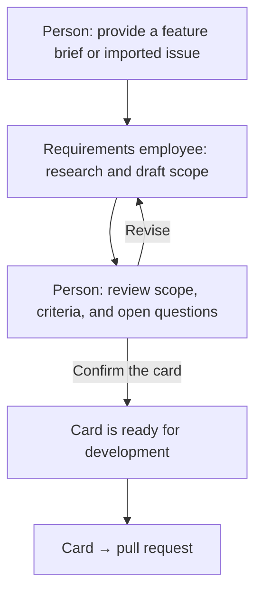

The Requirements lane turns a brief, an imported issue, or a rough note into a delivery card. The requirements employee researches readable repositories and drafts scope, acceptance criteria, and open questions. When clarification records the card as `READY`, the board can dispatch it to Development. A human confirmation can be part of the configured workflow.

This example shows a team reviewing the draft before handing it off. Check the target board’s intake rules for the configured steps.

Splitting a large brief means separate cards, each with criteria a reviewer can check. The board groups later test and release work in a batch. It does not keep a general dependency graph between cards. [Connect design to executable work](/learn/blueprints-work-orders/) is the method for writing the design that the card should carry.

## Where you participate

- **Define the outcome.** State the problem, the success criteria, the constraints, and what is out of scope. [Requirements writing](/learn/requirements-writing/) is the method for those criteria.
- **Review the draft.** You decide scope. The employee researches the current code and lists tradeoffs and open questions. Resolve the questions that would change the implementation before you hand the card on.
- **Confirm the card.** Confirmation tells the development lane to proceed for the stated repositories and criteria. It leaves merge, repository credentials, and pipeline setup unchanged.

Leave the card in Requirements while a criterion is still ambiguous. See [human approval](/user-guide/human-approval/) and [work intake](/software-factory/intake/).

## Lane employees

| Employee              | Role in this loop                                                                                                       |
| --------------------- | ----------------------------------------------------------------------------------------------------------------------- |
| Requirements employee | Researches, drafts scope and criteria, and asks for any required decisions.                                             |
| Development employee  | Implements the card after the board admits it to Development. See [Card → pull request](/software-factory/card-to-pr/). |

Assign a ready employee to the Requirements lane in the board wizard or in **Lane configuration**. The employee needs a grant only for repositories it should read. A grant to read is not a grant to push.

## Set it up

1. Connect the code host, and connect an issue source when the brief starts as an external issue. [Configure the Software Factory](/getting-started/first-software-factory/) has the connection steps.
2. Put a ready employee on the Requirements lane. Check **Execution identity** for that lane.
3. Start from **New requirements session** on the board, or route an inbox item into the project.
4. Read the draft, answer open questions on the card, and confirm scope, acceptance criteria, and allowed repositories.

## Next step

Use [Card → pull request](/software-factory/card-to-pr/) to turn the confirmed card into a draft change. A card that is already specific can start there.
