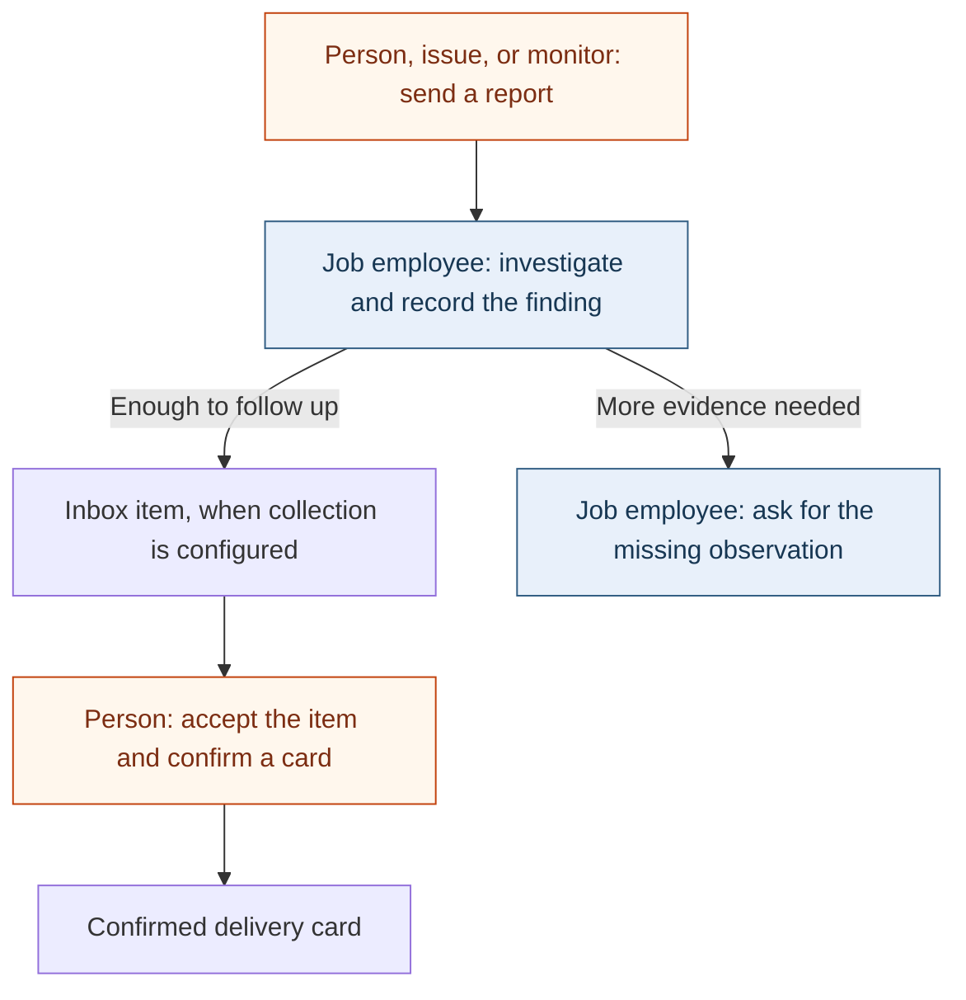

A signal is a report that might deserve engineering work: an imported or polled issue, a message that starts a Job, or a monitoring event. A Job employee investigates and writes what it found. **Collect tasks / issues** can save an inbox item when that step is on the Job and the run records a server receipt. The inbox item waits until a person accepts it and confirms a delivery card. Confirming the card is what allows development. The investigation itself does not change code, and creating the inbox item does not either.

People are marked in the diagram. Employees run the other steps.

Two sources use this shape.

**Issues and messages.** [Issue automation](/workflows/issue-automation/) polls GitHub issue events or imports tasks into the inbox. A messaging channel can start a Job from an allowed sender. The employee can summarize the report and, when collection is configured, file an inbox item. Collection uses a stable source identity so the same source is not filed twice. Matching that identity is the duplicate handling in this release.

**Incidents.** [Sentry](/integrations/sentry/) and [PagerDuty](/integrations/pagerduty/) can start a published Job when an issue or incident event arrives. The run holds the finding. The Job does not update the external incident, and it does not open a pull request. A code fix still starts from a confirmed card.

[Turn feedback into reviewed work](/learn/feedback-review/) is the method for separating the observation from the hypothesis before you confirm anything.

## Where you participate

- **Choose what is collected.** Select the GitHub events, the import source, the messaging channel, or the monitoring connection. Choose the inbox, or a workbench project, as the collection destination.
- **Supply the missing context.** Add the expected behavior, the reproduction, and the evidence that is not in the report. Treat the employee's wording as a finding to check, and keep the original report attached.
- **Authorize implementation.** Accepting an inbox item records that the report deserves follow-up. Confirming a card, with scope and repositories, is the step that lets the development lane proceed. Ask for a specific fix on that card. A monitoring run does not authorize a production change.

Request more information when the report cannot be investigated. Dismiss or archive it, with a reason, when no further work is needed. Keep unrelated problems as separate items.

## Lane employees

| Employee              | Role in this loop                                                                                                               |
| --------------------- | ------------------------------------------------------------------------------------------------------------------------------- |
| Job employee          | Investigates the signal, asks for missing evidence, and can file an inbox item when collection is on the Job.                   |
| Requirements employee | Clarifies a follow-up that is still too broad to implement. See [Requirements → card](/software-factory/requirements-to-card/). |
| Development employee  | Implements a card after you confirm it. See [Card → pull request](/software-factory/card-to-pr/).                               |

The Job employee does not need permission to push. The development employee does, and only after the card exists.

## Set it up

1. Connect the source the signal comes from: a [code host](/integrations/code-repositories/) for issues, a [messaging channel](/integrations/overview/), or [Sentry](/integrations/sentry/) or [PagerDuty](/integrations/pagerduty/). The employee that investigates needs access to the repository and the evidence it should read.
2. Create a Job on that employee. Add the event and the narrowest condition that should wake it. New rules start disabled. Preview a sample. Preview checks the match and does not create a run.
3. Publish the Job. Enable the rule after a manual run looks right. The first successful GitHub read establishes a baseline and does not replay history.
4. To file inbox items, add **Collect tasks / issues** and choose the inbox or a workbench project. The collection UI uses the Claude Code runtime. A sentence in chat is not a saved issue. An empty collection still records that nothing matched.
5. Open the run and the inbox item. Read the finding, the source identity, and the next action. Route a development-ready item to a board and confirm the card.

[Runs, results, and recovery](/automate/runs-recovery/) covers a failed, timed-out, or rejected run. A paused source does not admit waiting events. Turning it back on starts a new baseline.

## Next step

A confirmed card continues in [Card → pull request](/software-factory/card-to-pr/). A broader request goes to [Requirements → card](/software-factory/requirements-to-card/). A code fix still passes through [Pull request → merge](/software-factory/pr-to-merge/) before release.
