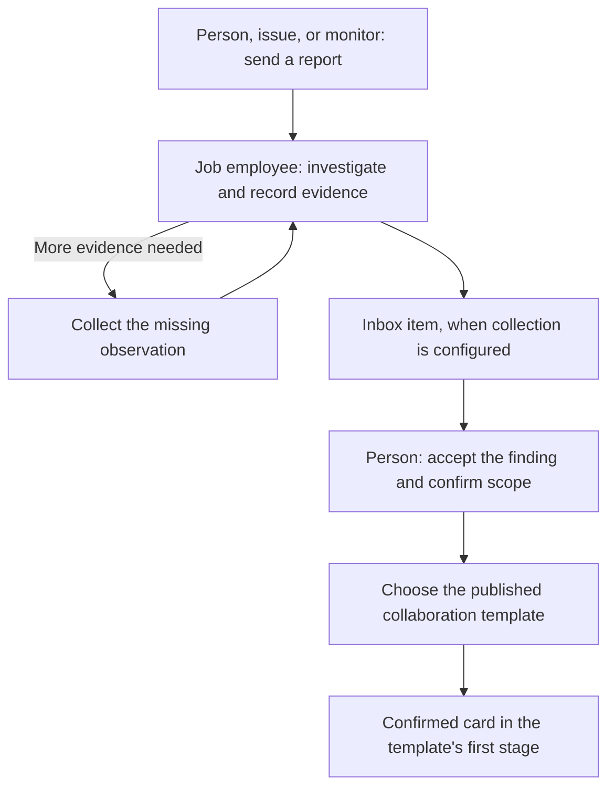

import MonitoringRoute from "../../../components/MonitoringRoute.astro";

A signal is a report that may deserve delivery work. It can be an imported issue, a message that starts a Job, or a monitoring event. The first step collects and investigates the report. The second step chooses a published collaboration template for the confirmed card.

The investigation does not change code. An inbox item becomes delivery work only after a person accepts the finding, confirms the scope, and chooses the scenario that matches the work.



## Choose the template after intake

Choose the scenario only after the person has confirmed what needs to happen and which evidence is available.

| Confirmed outcome                                      | Collaboration template               | First handoff artifact |
| ------------------------------------------------------ | ------------------------------------ | ---------------------- |
| A customer report needs a fix, verification, and reply | `customer-escalation-to-product-fix` | `reproduction`         |
| An incident needs a sourced timeline and retrospective | `incident-investigator`              | `event_timeline`       |
| A support question exposes a documentation gap         | `docs-gap-from-support-ticket`       | `gap_analysis`         |
| A confirmed issue is ready for implementation          | `pr-author`                          | `implementation_brief` |

The intake item remains the source record. The selected template carries the confirmed card through its stages and completion rule. See [Collaboration templates](/software-factory/templates/) for the full catalog.

## Sources and collection

**Issues and messages.** [Issue automation](/workflows/issue-automation/) can poll issue events or import tasks into the inbox. A messaging channel can start a Job from an allowed sender. When collection is configured, the Job can save an inbox item with a stable source identity.

**Incidents.** [Sentry](/integrations/sentry/) and [PagerDuty](/integrations/pagerduty/) can start a published Job when an event arrives. The run holds the finding until a person decides whether it deserves a card. [Turn feedback into reviewed work](/learn/feedback-review/) explains how to separate observations from hypotheses.

## Production alert example

<MonitoringRoute />

## Where you participate

- **Choose what is collected.** Select the event source and the destination for the finding. Keep the original report attached to the inbox item.
- **Supply missing context.** Add expected behavior, reproduction details, impact, and evidence that is absent from the report.
- **Choose the work.** Confirm the card's scope, repository and environment boundary, then select the collaboration template that owns the next stages.

Request more information when the report cannot be investigated. Dismiss or archive it with a reason when no follow-up is needed. Keep unrelated problems as separate items.

## Configure the intake and template

1. Connect the source that produces the signal, such as a code host, messaging channel, Sentry, or PagerDuty.
2. Create and publish a Job on the employee that investigates the signal. Use the narrowest event condition and preview a sample before enabling it.
3. Add **Collect tasks / issues** when the finding should become an inbox item or enter a workbench project.
4. Open the run and the inbox item. Review the source identity, finding, and missing context.
5. Confirm the card and choose the published collaboration template. Bind ready employees to that template's required stages.

[Runs, results, and recovery](/automate/runs-recovery/) covers failed, timed-out, or rejected collection runs.

## Template for a signal investigation

Copy this into the investigating Job’s findings. If the Job collects an inbox item, keep the source and run receipt with it so the reviewer can check the report.

```text
Source and original report — [source ID or link] [what the reporter saw]
Reproduction — [environment, steps, expected and actual behavior]
Evidence — [observation or artifact] [what is still a hypothesis]
Disposition — [follow up / request evidence / archive] [reason]
Handoff — [inbox item and run receipt, if collected] [card, once accepted and confirmed]
```

**Example.** In Issue #42 a user reports that exporting a filtered order list includes all orders. The investigator reproduces it with three sample orders. The screen shows one row, the CSV contains three. Attach the sample CSV to the finding. The reviewer accepts the item for follow-up and asks how an empty result should export before confirming the card.

## Continue with the selected template

A request that needs shaping continues in [Requirements → card](/software-factory/requirements-to-card/). A confirmed card ready for implementation continues in [Card → pull request](/software-factory/card-to-pr/). A code change awaiting evidence continues in [Pull request → merge](/software-factory/pr-to-merge/).
