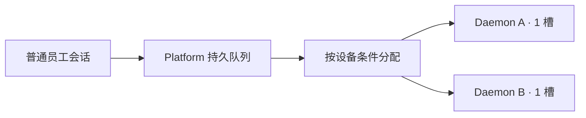

执行池把你已配对的 Daemon 组成一个执行目标。每个设备身份提供一个槽。两台符合条件的设备都在执行时，第三个会话可以排队。会话首次获配设备后，续聊会回到这台设备及其工作目录。

:::note[可用条件]
本章以 [Platform PR #1188](https://github.com/WeiJiLab/aiworkforce-platform/pull/1188) 的候选实现为准。下列流程需要目标环境部署包含该改动的前后端，并完成对应的数据库迁移。如果你的环境只提供单台设备选项，请参阅[会话执行位置](/zh-cn/deployment/daemon/session-execution/)。
:::

## 配对设备并创建执行池

1. 用同一个 Platform 账号分别批准各个 Daemon 的配对。在**个人设置 → 设备连接**核对设备和工作目录。配对前置条件和浏览器批准步骤见[我的机器](/zh-cn/deployment/daemon/my-machines/)。
2. 在**执行池**点击标为**创建执行池**的加号。填写名称，勾选至少一台设备，再选择**保存执行池**。成员在创建时固定，须是自己尚未撤销且支持 `device_rpc` 的已配对 Daemon。已配对的离线设备也可以加入。
3. 新建 Claude Code 数字员工的普通会话。在发送第一条消息前，从输入框上方的**执行位置**选择有名称的执行池。名称旁的槽位数是配置容量。会话用设备工具读取配对工作区里的文件。此执行位置不接受聊天附件。
4. 发送消息。排队时，输入框附近会显示等待原因。分配后，聊天通知会显示设备名和工作目录。需要换池或工作目录时，新建会话并重新选择执行位置。

同一个设备始终只有一个槽。多个池选到同一个设备时，共用这一个槽。直接选择该设备的会话也占用同一个槽。

### 连接两个 Daemon

在本地试用时，准备两个已存在的独立项目目录和两个位于工作目录之外的状态路径。替换示例地址和路径，分别执行配对命令并在浏览器中批准。远程主机可以加 `--no-browser`，再到另一台设备打开终端打印的授权链接。

```sh
aiworkforce-device-exec connect --workspace /absolute/project/pool-a \
  --platform https://platform.example.org --name pool-a \
  --state-dir /absolute/device-state/pool-a

aiworkforce-device-exec connect --workspace /absolute/project/pool-b \
  --platform https://platform.example.org --name pool-b \
  --state-dir /absolute/device-state/pool-b

aiworkforce-device-exec status --json --state-dir /absolute/device-state/pool-a
aiworkforce-device-exec status --json --state-dir /absolute/device-state/pool-b
```

状态目录保存设备凭据和执行日志。命令以 Daemon 的操作系统用户身份运行，配对目录提供项目上下文并作为命令的工作目录。分配到同一台设备的会话可以看到前一个回合留下的文件。同一宿主上的两个 Daemon 共用操作系统，可能同时受到宿主故障影响。需要独立故障边界时，使用独立主机、容器或虚拟机。现有 Kubernetes 示例覆盖单台设备及其持久卷。 [设备执行器 CLI](/zh-cn/integrations/cli/) · [在 Kubernetes 上运行设备执行器](/zh-cn/deployment/self-host/#在-kubernetes-上运行设备执行器)

## 平台怎样为回合分配设备



1. **入队。** 平台在 PostgreSQL 中创建状态为 `queued` 的回合。即使会话已有设备绑定，本次回合在排队时也尚未获配设备。协调器最多等待五分钟。等待期间，该回合的模型循环和设备命令均未启动。
2. **匹配。** 候选设备须有有效原生连接、在线、具备 `device_rpc` 能力且有空闲槽。对每台设备，平台比较池内最早的未绑定回合与最早绑定到该设备的回合，先看入队时间，再看 Run ID。某条续聊等设备 A 时，另一条未绑定回合仍可获配设备 B。
3. **占槽并执行。** 平台在同一个数据库事务中复核设备状态、占槽、写入首次设备绑定，并把回合推进到 `pending`。随后平台运行 Claude Code 模型循环，经 Daemon 主动建立的 WebSocket 连接发送项目工具调用。Daemon 执行并返回工具结果和停止回执。
4. **释放槽并续聊。** 平台结束回合并核实设备停止状态后，该槽可供其他会话使用。原会话在空闲时继续保留设备绑定。若原设备仍被占用或暂不可用，下一轮会等待它，即使池里有其他可用槽。

用户在浏览器选池、查看进度。消息提交后，调度和设备执行由平台与已连接的 Daemon 继续负责。 [池匹配规则](https://github.com/WeiJiLab/aiworkforce-platform/blob/d5f1715b0a3b32e409495de17a9a2cef9817d8bf/backend/domain/local_execution/model/execution_pool.py) · [占槽事务](https://github.com/WeiJiLab/aiworkforce-platform/blob/d5f1715b0a3b32e409495de17a9a2cef9817d8bf/backend/infr/repository/local_execution_repository_impl.py) · [设备工具派发](https://github.com/WeiJiLab/aiworkforce-platform/blob/d5f1715b0a3b32e409495de17a9a2cef9817d8bf/backend/application/session/device_execution_target.py)

## 查看槽位与等待原因

执行池面板显示配置容量、可分配槽、占用槽和不可用槽，也会列出设备状态、排队回合数，以及有回合排队时的最久等待时间。

| 槽位统计 | 设备状态                                                                                                 |
| -------- | -------------------------------------------------------------------------------------------------------- |
| 可分配   | 就绪。                                                                                                   |
| 占用     | 正在执行或停止确认中。当前回合收尾前仍占用容量。                                                         |
| 不可用   | 离线、隔离、撤销、客户端不支持或其他不可用状态。设备可以已重新连上，同时因上一轮执行尚未确认而继续隔离。 |

聊天提示根据该会话可用的候选设备显示等待原因。

| 聊天中的等待原因     | 怎样处理                                                         |
| -------------------- | ---------------------------------------------------------------- |
| 等待执行池分配设备   | 有符合条件的空闲槽，等待协调器按设备对应的队列顺序分配。         |
| 池设备正在执行或停止 | 符合条件的槽已被占用，释放后匹配的回合可以继续派单。             |
| 暂无可调度设备       | 到**执行池**核对各设备的连接、授权、客户端能力或隔离状态。       |
| 等待已绑定的设备     | 核对提示中的设备名称和状态。池里有其他可用槽时，续聊仍等原设备。 |

## 取消和恢复

- **分配前取消。** 取消先提交时，排队回合结束，设备命令派发数为零。分配与取消同时发生时，以已提交的回合状态为准。已经取得设备租约的工作按停止流程收尾。
- **等待超时。** 回合标为中断。检查执行池和设备状态后，可在原会话发新消息。已有设备绑定的会话仍使用原设备。
- **执行中断线。** 受影响的回合会中断。其他设备各持有自己的租约，只要仍正常且能确认停止，就能继续执行。如果 worker 已停止，用原状态目录启动，例如 `aiworkforce-device-exec start --state-dir /absolute/device-state/pool-a`。确认设备可分配后，在原会话发新消息。原回合保留中断记录，平台不会自动把旧命令重放到另一台设备。命令结果未知时，先核对工作目录和回执，再决定是否重新执行。
- **停止待确认或设备已隔离。** 在对应 Daemon 的 `--state-dir` 上运行 `status --json`、`doctor --json` 和只读的 `stop-review --json`，保留执行日志。浏览器已取消、设备已重连或平台租约已到期，都不能代替停止回执或受支持的恢复凭证。 [自托管机器故障排查](/zh-cn/deployment/daemon/troubleshooting/)
- **平台协调器重启。** 遗留回合在租约到期后由对账收尾，标为中断。终态提交后，PostgreSQL 通知会唤醒聊天对账，漏通知由周期对账补上。聊天恢复可发新消息时，设备槽仍可能等待停止确认。 [会话对账源码](https://github.com/WeiJiLab/aiworkforce-platform/blob/d5f1715b0a3b32e409495de17a9a2cef9817d8bf/backend/application/session/session_reconciliation_service.py)

## 部署和检查候选版本

使用同一 Platform 候选版本的前后端，沿用设备配对、出站 WSS 路由 `/api/daemon/v2/connect`、PostgreSQL 和 Claude Code 渠道。从候选版本的 `backend` 目录，用部署现有的数据库配置执行 expand 迁移。校验数据库结构后，再启动配套服务。

```sh
python -m scripts.run_migrations --phase expand
python -m scripts.verify_schema_contract
```

迁移 `20270101_execution_pools` 新增池表，允许池会话与排队回合暂时没有分配设备。降级会检查是否已有池记录、池绑定或排队回合，避免丢弃这些数据。 [迁移源码](https://github.com/WeiJiLab/aiworkforce-platform/blob/d5f1715b0a3b32e409495de17a9a2cef9817d8bf/backend/infr/repository/migrations/versions/20270101_execution_pools.py)

以下候选接口使用当前登录的 Platform 账号。

| 接口                                                 | 请求或结果                                                                                               |
| ---------------------------------------------------- | -------------------------------------------------------------------------------------------------------- |
| `POST /api/local-execution/pools`                    | 提交 `name`（去掉首尾空白后为 1–120 个字符）与 `machine_ids`（1–100 个互不重复的设备 UUID）。            |
| `GET /api/local-execution/pools`                     | 从 `data.pools` 读取自己的执行池，字段包括 `capacity`、`workers`、`queued_count` 和 `oldest_queued_at`。 |
| `PUT /api/sessions/{session_id}/execution-device`    | 用 `pool_id` 为自己未开始的普通会话选择执行池。直接选设备使用 `machine_id`，两个目标字段最多一个非空。   |
| `GET /api/sessions/{session_id}/execution-pool-wait` | 查询自己的池会话等待情况。排队时从 `data.wait` 读取 `reason`、`queued_at`，以及适用时的绑定设备状态。    |

[池接口源码](https://github.com/WeiJiLab/aiworkforce-platform/blob/d5f1715b0a3b32e409495de17a9a2cef9817d8bf/backend/ohs/http/local_execution_router.py) · [会话接口源码](https://github.com/WeiJiLab/aiworkforce-platform/blob/d5f1715b0a3b32e409495de17a9a2cef9817d8bf/backend/ohs/http/session_router.py)

## Cursor Team Pools 怎样供给容量

Cursor Team Pools 面向由团队管理的 Enterprise 基础设施。Cursor 云端负责 Agent 循环、模型访问和路由，团队环境里的 worker 执行工具。管理员启用 Self-Hosted Machines 并提供服务账号。采用先领取再启动的模式时，控制器可以为单次领取签发会话令牌，将长期密钥留在控制器。 [Cursor Team Pools](https://cursor.com/docs/cloud-agent/self-hosted/pool) · [会话令牌](https://cursor.com/docs/cloud-agent/self-hosted/pool#session-tokens)

| 维度       | AI Workforce 固定容量池                                  | Cursor Team Pools                                                                                                                  |
| ---------- | -------------------------------------------------------- | ---------------------------------------------------------------------------------------------------------------------------------- |
| 路由       | 会话所有者选择一个由已配对设备组成的个人池。             | 请求指向命名团队池。仓库池匹配仓库和池标签。Any-repo 池按池名匹配，可选择在领取请求时检出仓库。                                    |
| 容量       | 由预先配对且达到可用条件的 Daemon 提供。                 | 可以运行常驻 worker。CLI controller 也可先领取请求，再调用启动脚本，或用 `--warm-idle` 维持一定数量的空闲 worker，由 Cursor 分配。 |
| 占槽时长   | 按回合占用设备，确认停止后可释放槽，会话绑定保留。       | 一个 worker 进程服务一个 Cloud Agent，回合之间继续保留到空闲释放窗口结束，默认一小时。                                             |
| 释放后续聊 | 续聊等待原设备和工作目录。                               | 释放后可以重新获取池容量。启用休眠与重连窗口时，运维方可从快照恢复原工作区。                                                       |
| 状态和队列 | 池面板显示槽位与最长等待时间，聊天显示该会话的等待原因。 | 池 API 提供连接和占用计数，外部控制器可通过待派列表和 SSE 流查看排队请求。                                                         |

[Cursor any-repo 池](https://cursor.com/docs/cloud-agent/self-hosted/pool#any-repo-pools) · [Worker controller](https://cursor.com/docs/cloud-agent/self-hosted/pool#worker-controller) · [会话生命周期](https://cursor.com/docs/cloud-agent/self-hosted/pool#session-lifecycle) · [休眠](https://cursor.com/docs/cloud-agent/self-hosted/pool#hibernation) · [Cursor Kubernetes 示例](https://github.com/anysphere/k8s-workers)

## 用两个槽和三个会话复验

使用隔离的 Platform 部署和 PostgreSQL、两个独立配对且工作目录不同的 Daemon，以及浏览器里的普通账号。给每个测试回合一个唯一标记，记录设备、工作目录和工具回执。测试命令把标记追加到文件，以便发现重复执行。

| 操作                                                        | 观察结果                                                                           |
| ----------------------------------------------------------- | ---------------------------------------------------------------------------------- |
| 先让两个会话各占一台设备，再向第三个会话发送第一条消息。    | 两个槽占用，第三个回合排队且没有设备命令回执。                                     |
| 第三个回合仍在排队时取消，再在该会话发新消息。              | 两台设备都没有被取消回合的标记，新回合进入队列。                                   |
| 第二台设备执行时，断开第一台 Daemon。                       | 第一个回合中断，第二个仍可完成。第二台设备确认停止后，第三个会话可使用它释放的槽。 |
| 用原状态目录重新连接第一台 Daemon，再在第一个会话发新消息。 | 续聊沿用原设备和工作目录。旧回合仍为中断，旧标记最多写入一次。                     |
| 有回合未结束时重启 Platform 协调器。                        | 遗留 Run 在租约到期后收尾，漏通知时也能对账。复用设备槽之前仍需核实停止凭证。      |

也可以直接运行候选版本的定向测试。使用部署对应的 Python 依赖，将现有的 `AIWORKFORCE_TEST_DATABASE_URL` 指向允许创建临时 schema 的可丢弃 PostgreSQL 数据库。未设置时，PostgreSQL 竞态测试会跳过。在 `backend` 目录执行以下命令。

```sh
python -m pytest -q tests/test_native_daemon_acceptance.py \
  tests/test_native_execution.py tests/test_local_execution_domain.py \
  tests/test_session_startup_reconciliation.py
```

调研用真实 Platform、PostgreSQL、浏览器会话和 Daemon 工具调用在本地联调，模型响应来自确定性替身。调研也复现了同一台 macOS 宿主机上有一个 worker 无法确认停止、后续队列未接续的情况。请在实际使用的 Daemon 版本和部署拓扑上复验隔离能力。Cursor 调研核对了本机 CLI 的 worker 和 controller 帮助，本文所述 Enterprise 路由及生命周期来自 Cursor 官方文档。 [Platform 候选实现和验收记录](https://github.com/WeiJiLab/aiworkforce-platform/pull/1188)
