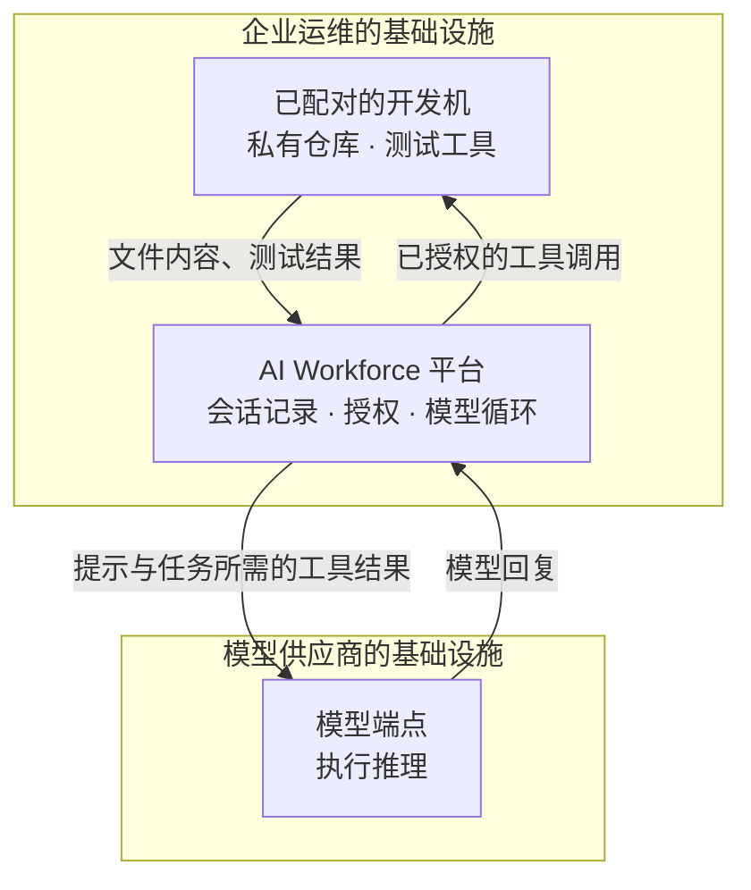

把私有仓库的一项修复交给数字员工，让它在能访问内部测试服务的开发机上验证变更。团队决定员工可以访问哪个仓库、用哪台设备、调用哪个模型。AI Workforce 管理会话、检查工具授权，并保存执行记录供团队审阅。

## 一次私有仓库测试在哪里运行？

下图以企业自托管平台、使用已配对的开发机和外部模型服务为例。箭头表示任务数据的流向。设备主动向平台建立连接，再通过这条连接接收命令、返回结果。

## 按企业要求选择部署位置

**会话记录要由企业保管。** 在企业运维的主机上部署平台。后端驱动模型调用，PostgreSQL 保存会话和自动化状态，持久化数据卷保存工作空间文件。企业负责升级、备份和恢复。也可以使用运营方托管的平台，由运营方维护这套服务。[自托管部署指南](/zh-cn/deployment/self-host/)

**测试必须在指定设备上运行。** 在发送第一条消息前，为会话选择已配对的在线设备。工具以该设备上的操作系统用户身份运行，配对目录是起始目录，文件访问范围由系统权限决定。如果任务只需平台已连接的资源，可以直接选用平台执行。[选择会话执行位置](/zh-cn/deployment/daemon/session-execution/)

**推理请求必须留在内网。** 为员工的运行内核配置在内网完成推理的模型端点。若使用图中的外部端点，它会收到本次调用所需的提示、读取的文件内容和工具结果，即使仓库和会话数据库都部署在企业机器上。[配置模型渠道](/zh-cn/administration/configuration/)

## 团队如何验收这次修复？

审阅者在员工会话中检查执行的命令和测试输出，再到交付卡片核对测试覆盖的提交是否与待合并版本一致。版本一致且满足验收条件后，由团队决定是否合入。[从 Issue 到 PR](/zh-cn/recipes/issue-to-pr/)
