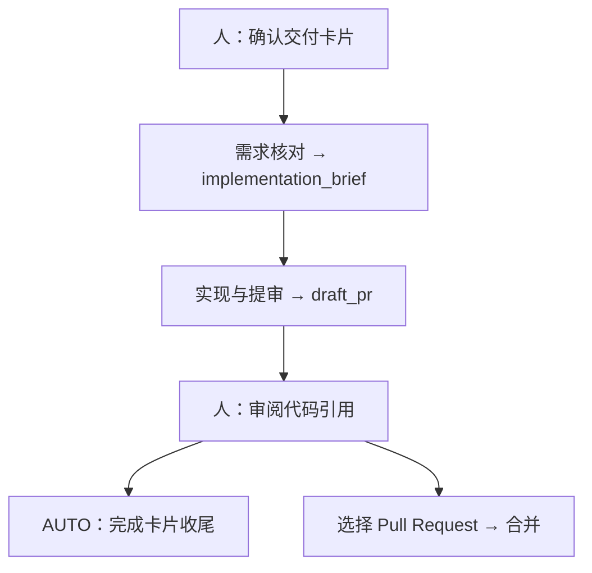

卡片已经确认范围并准备进入实现时，使用已发布的 `pr-author` 协作模板。模板会在员工修改仓库前记录授权和实现边界。

需求核对产出 `implementation_brief`，其中记录已批准范围、验收条件、目标仓库和授权。实现与提审读取这个产物，完成变更并运行相关检查，产出 `draft_pr`，其中记录 Pull Request 或分支、准确提交和检查结果。

## 模板交接契约

| 阶段       | 读取内容                          | 产出                                                    | 人需要做的决定                     |
| ---------- | --------------------------------- | ------------------------------------------------------- | ---------------------------------- |
| 需求核对   | 已确认卡片及其授权                | 包含范围、标准、仓库和访问边界的 `implementation_brief` | 确认实现可以修改什么               |
| 实现与提审 | `implementation_brief` 和获准仓库 | 包含代码引用、准确提交和检查结果的 `draft_pr`           | 审阅变更，并用证据退回未通过的标准 |

实现阶段通过模板的 `requires` 映射接收 `implementation_brief`。仓库授权必须覆盖该阶段需要执行的分支和 Pull Request 操作。Issue 触发器使用的轮询令牌不会自动获得这些操作权限。

## 配置模板

1. 打开**工作台 → 新建交付项目**，从已发布协作模板中选择 `pr-author`。
2. 连接代码托管，并授予实现阶段访问目标仓库的权限。检查阶段的执行身份。
3. 为需求核对和实现与提审绑定就绪员工。
4. 把已准备好的收件箱事项路由到项目，或在第一个阶段创建已确认卡片。
5. 跟进执行记录，查看 `implementation_brief` 和 `draft_pr`，再进入代码审阅。

该模板使用 `AUTO`，最后阶段返回 `READY` 并完成收尾后，卡片可以自动完成。合并和生产发布仍然是独立决定。

## 继续使用下一个模板

使用[Pull Request → 合并](/zh-cn/software-factory/pr-to-merge/)选择适合审阅、修复、验证和发布的证据模板。[Issue 到 PR](/zh-cn/recipes/issue-to-pr/)示范了从收件箱到草稿 Pull Request 的完整路径。
