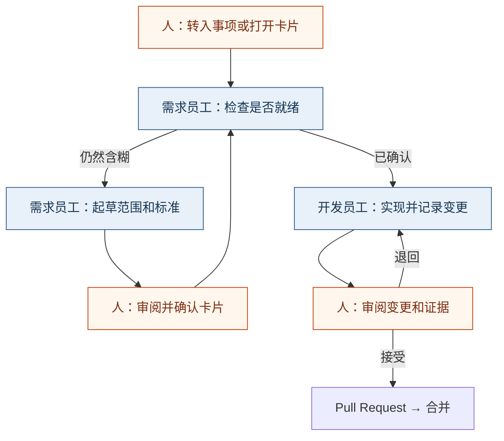

这条回路从团队已经接受的卡片开始，或从你转入看板的收件箱事项开始。需求员工检查问题、结果、范围和目标仓库。含糊的卡片留在澄清状态，直到你确认。边界清楚的卡片进入开发。开发员工实现变更，运行已配置的检查，并在卡片上记录 Pull Request、分支或提交。

图中标出的是人。其余步骤由员工执行。

任务已经具体时，也可以直接打开开发会话。会话需要范围决定时，卡片会等待你的确认，然后变更才继续。检查通过不会自动记成你的接受。

完整示例是 [Issue 到 PR](/zh-cn/recipes/issue-to-pr/)。已有看板上的点击路径是[快速入门](/zh-cn/getting-started/quickstart/)。

## 你在哪些地方参与

- **给出范围。** 写明期望行为、验收标准、约束，以及变更可以接触的仓库。
- **确认起草的规格。** 解决未决的产品问题，并确认要构建的内容。说明仍然很大时，这一步审阅是[需求到卡片](/zh-cn/software-factory/requirements-to-card/)。
- **审阅变更。** 阅读 diff、测试结果，以及员工报告的缺口。在卡片上记录决定。退回失败的验收标准时带上证明它的证据。

会话期间，在卡片上回答问题和批准请求。接管会停止自动推进。需要继续时明确交还。共享批次可能包含其他卡片，批次操作之前先看成员。

## 泳道员工

| 员工     | 在这条回路里的职责                                                                                       |
| -------- | -------------------------------------------------------------------------------------------------------- |
| 需求员工 | 检查是否就绪，补上缺失的范围，并在你确认之前把卡片留在需求泳道。                                         |
| 开发员工 | 实现，运行已配置的检查，并记录代码引用。你退回卡片时修复它。                                             |
| 测试员工 | 看板运行测试泳道时，记录候选版本的验证。见 [Pull Request 到合并](/zh-cn/software-factory/pr-to-merge/)。 |

开发员工需要覆盖你期望操作的仓库授权。路径应打开 Pull Request 时，授权要包括创建分支和 Pull Request。GitHub 触发器使用的轮询令牌不授予这些操作。

## 如何配置

1. 连接代码托管，并给开发员工授予仓库。步骤见[配置软件工厂](/zh-cn/getting-started/first-software-factory/)和[代码仓库](/zh-cn/integrations/code-repositories/)。
2. 为需求泳道和开发泳道指派就绪员工。在**泳道配置**中核对每条泳道的**执行身份**。
3. 把就绪的收件箱事项转入项目，或确认需求会话已经起草的卡片。
4. 从交付工作台 `/automations?tab=board-flow` 打开卡片。**执行**通向会话，**交付物**通向代码引用。

## 下一步

验证、修复和发布决定继续看 [Pull Request 到合并](/zh-cn/software-factory/pr-to-merge/)。每个已记录阶段的核对清单是[审阅与发布](/zh-cn/software-factory/review-release/)。
