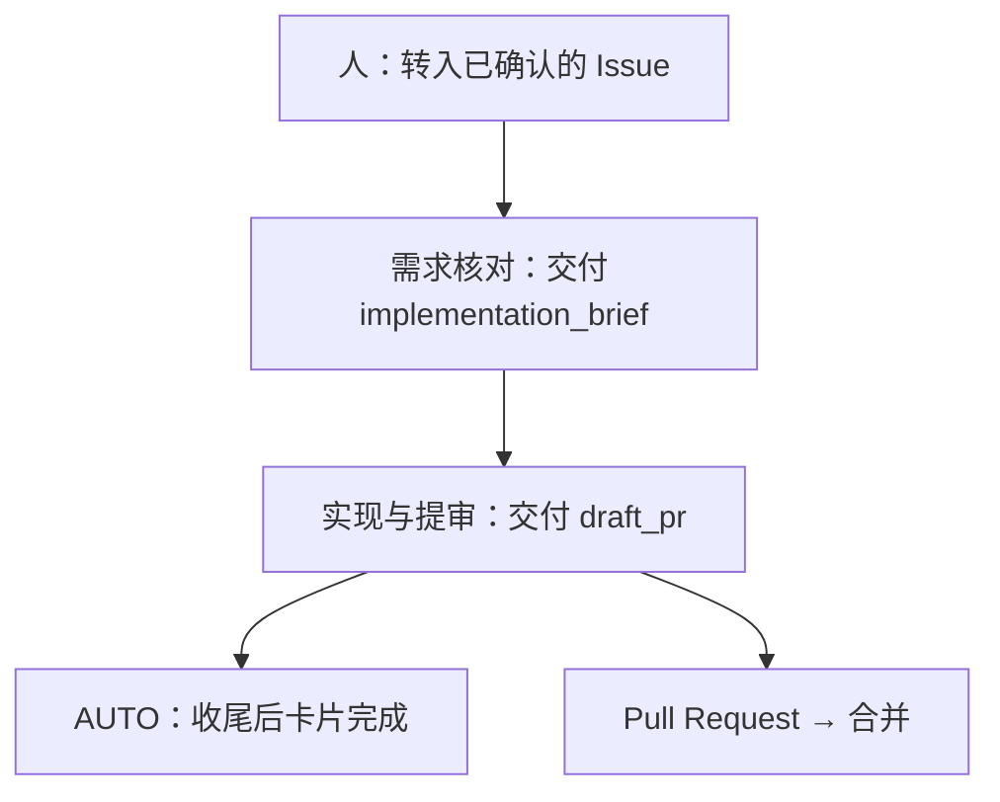

`pr-author` 模板把已确认的 Issue 变成可审阅的代码引用。第一个阶段「需求核对」交付 `implementation_brief`，包含已确认的范围、验收条件、目标仓库和授权。第二个阶段「实现与提审」读取这个工作单，实现变更，运行相关检查，并交付包含链接、提交和检查结果的 `draft_pr`。

模板使用 `AUTO`，因此最后一个阶段返回 `READY` 并完成收尾后，卡片可以自动完成。合并和生产发布仍然是独立的看板或仓库决定。

泳道派发后，可从卡片打开开发会话。会话需要范围决定时，卡片会等待你的确认，然后变更才继续。检查通过不会自动记成你的接受。

完整示例是 [Issue 到 PR](/zh-cn/recipes/issue-to-pr/)。已有看板上的点击路径是[快速入门](/zh-cn/getting-started/quickstart/)。完整场景目录见[BoardFlow 看板模板](/zh-cn/software-factory/templates/)。

## 你在哪些地方参与

- **给出范围。** 写明期望行为、验收标准、约束，以及变更可以接触的仓库。
- **确认起草的规格。** 解决未决的产品问题，并确认要构建的内容。说明仍然很大时，这一步审阅是[需求到卡片](/zh-cn/software-factory/requirements-to-card/)。
- **审阅变更。** 阅读 diff、测试结果，以及员工报告的缺口。在卡片上记录决定。退回失败的验收标准时带上证明它的证据。

会话期间，在卡片上回答问题和批准请求。接管会停止自动推进。需要继续时明确交还。共享批次可能包含其他卡片，批次操作之前先看成员。

## 交接契约

| 阶段       | 输入                                    | 输出                                                       |
| ---------- | --------------------------------------- | ---------------------------------------------------------- |
| 需求核对   | 已确认的 Issue 及其授权                 | `implementation_brief`，包含范围、验收条件、仓库和访问边界 |
| 实现与提审 | `implementation_brief` 及获准访问的仓库 | `draft_pr`，包含 Pull Request 或分支、准确提交和检查结果   |

实现阶段通过模板的 `requires` 映射接收第一个阶段的产物。仓库授权需要覆盖阶段预期执行的创建分支和 Pull Request 操作。GitHub 触发器使用的轮询令牌不提供这些操作。

## 如何配置

1. 在**工作台 → 新建交付项目**选择已发布的 `pr-author` 模板。场景目录见[BoardFlow 看板模板](/zh-cn/software-factory/templates/)。
2. 连接代码托管，并为实现阶段授予仓库权限。步骤见[配置软件工厂](/zh-cn/getting-started/first-software-factory/)和[代码仓库](/zh-cn/integrations/code-repositories/)。
3. 为「需求核对」和「实现与提审」绑定就绪员工。在**泳道配置**里核对每个阶段的**执行身份**。
4. 把就绪的收件箱事项转入项目，或打开已确认的卡片。沿着**执行**查看阶段结果，沿着**交付物**查看 `draft_pr`。

## 下一步

验证、修复和发布决定继续看 [Pull Request 到合并](/zh-cn/software-factory/pr-to-merge/)。每个已记录阶段的核对清单是[审阅与发布](/zh-cn/software-factory/review-release/)。
