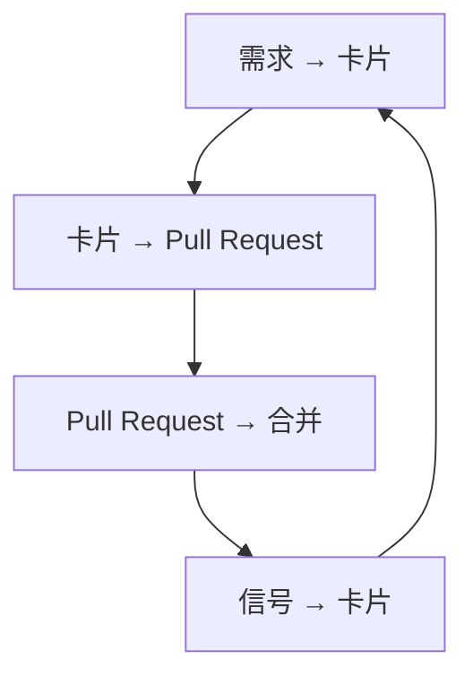

如果每一步交接都要重新给员工下指令，人就会花时间协调软件交付。软件工厂把交付看板的泳道连成四条回路，已确认的卡片可以走过实现、验证和发布，而不必在每一列都重新写提示。人保留判断：范围、证据审阅，以及变更是否交付。

产品界面是**交付工作台**。在主导航打开**工作台**。地址是 `/automations?tab=board-flow`。它与[看板工作台](/zh-cn/workflows/kanban-workbench/)和 [Issue 自动化](/zh-cn/workflows/issue-automation/)共用工作流、自动化、员工和证据。

## 整条流程

泳道员工把一项需求带到经过审阅的变更。项目接上的流水线部署已合并的版本。反馈和事件在有人确认后续工作之后，成为下一张卡片。



**卡片**是这些回路交接的工作项。导入的 GitHub、GitLab、云效、Jira 或 Linear 事项，在转入项目并确认之后成为这张卡片。卡片保留已确认的范围、会话、代码引用、测试记录和人工决定。

## 四条回路

| 回路                | 向前推进的是什么                                                    | 指南                                                        |
| ------------------- | ------------------------------------------------------------------- | ----------------------------------------------------------- |
| 需求 → 卡片         | 功能说明变成经过审阅的范围和一张已确认的卡片。                      | [需求到卡片](/zh-cn/software-factory/requirements-to-card/) |
| 卡片 → Pull Request | 已确认的卡片变成已实现的变更，卡片上留下 Pull Request、分支或提交。 | [卡片到 Pull Request](/zh-cn/software-factory/card-to-pr/)  |
| Pull Request → 合并 | 经过审阅的变更被修复、验证，并交给人做合并和发布决定。              | [Pull Request 到合并](/zh-cn/software-factory/pr-to-merge/) |
| 信号 → 卡片         | 反馈或事件先被调查，再由人决定哪一项后续工作成为卡片。              | [信号到卡片](/zh-cn/software-factory/signal-to-card/)       |

每篇指南说明这条回路的泳道员工、人做决定的位置，以及配置步骤。

## 从哪里开始

先做限制吞吐的那一条回路。先配置它。

| 团队卡在哪里               | 从这里开始                                                                                                 |
| -------------------------- | ---------------------------------------------------------------------------------------------------------- |
| 请求还只是一段说明         | [需求 → 卡片](/zh-cn/software-factory/requirements-to-card/)                                               |
| 清晰的事项在等代码         | [卡片 → Pull Request](/zh-cn/software-factory/card-to-pr/)或[快速入门](/zh-cn/getting-started/quickstart/) |
| 变更停在审阅或发布         | [Pull Request → 合并](/zh-cn/software-factory/pr-to-merge/)                                                |
| 报告一直变不成工作         | [信号 → 卡片](/zh-cn/software-factory/signal-to-card/)                                                     |
| 看板、仓库或员工还没准备好 | [配置软件工厂](/zh-cn/getting-started/first-software-factory/)                                             |

## 回路如何落在看板上

内置泳道按顺序是：

```text
需求 → 开发 → 测试发布 → 测试验证 → 生产发布 → 已完成
```

| 回路                | 看板上由什么承载                                                         |
| ------------------- | ------------------------------------------------------------------------ |
| 需求 → 卡片         | 需求泳道。人确认范围、验收标准，以及变更可以接触的仓库。                 |
| 卡片 → Pull Request | 开发泳道。泳道员工在会话中工作，并记录 Pull Request、分支或提交。        |
| Pull Request → 合并 | 测试发布、测试验证和生产发布。仓库和流水线已连接时，合并和生产才会执行。 |
| 信号 → 卡片         | 收件箱和采集 Job。已确认的后续工作进入需求泳道。                         |

泳道内的步骤是执行状态。自定义看板可以有不同安排。没有在制品上限。要一起测试的卡片可以共享一个批次。关闭批次只结束该批次的收尾。生产发布另有记录。

## 人保留决定

确认草稿之后，开发泳道可以继续。仓库凭据和流水线配置仍在工作空间和项目上。执行过程中，在卡片上回答问题。接管会停止自动推进并保留当前状态。需要继续时明确交还。只恢复暂停，接管仍然有效。对共享批次的操作可能影响其中每张卡片。

决定周围的记录见[证据](/zh-cn/software-factory/evidence/)、[质量门禁](/zh-cn/software-factory/quality-gates/)和[发布治理](/zh-cn/software-factory/release-governance/)。

## 相关指南

- [Issue 自动化](/zh-cn/workflows/issue-automation/)在事项成为卡片之前采集或轮询它们。
- [看板工作台](/zh-cn/workflows/kanban-workbench/)就是这块看板，按泳道、卡片和批次来读。
- [Pull Request 自动化](/zh-cn/workflows/pull-request-automation/)在轮询到匹配的 GitHub Pull Request 事件时启动 Job。
- [Issue 到 PR](/zh-cn/recipes/issue-to-pr/)用一个例子从收件箱走到审阅决定。
