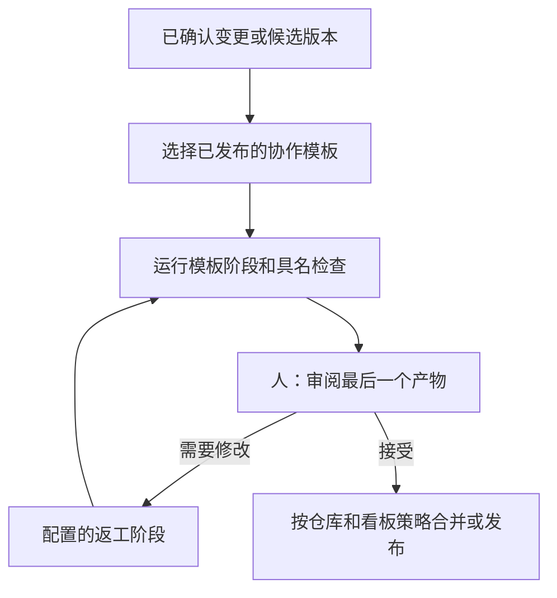

Pull Request 本身不会决定交付流程。根据卡片需要的证据和决定，选择已发布的协作模板。所选模板定义阶段、具名产物、返工路径和完成规则。

需要对照规格进行重点检查时，使用 `pr-spec-adherence-check`。客户报告需要复现、修复、验证和回复草稿时，使用 `customer-escalation-to-product-fix`。候选版本需要基于证据做就绪决定时，使用 `release-candidate-readiness-review`。



## 选择证据模板

| 模板                                 | 适用场景                                 | 关键交接产物                                                     | 完成方式       |
| ------------------------------------ | ---------------------------------------- | ---------------------------------------------------------------- | -------------- |
| `pr-spec-adherence-check`            | Pull Request 需要对照规格进行可追溯检查  | `acceptance_criteria` → `adherence_report`                       | `AUTO`         |
| `customer-escalation-to-product-fix` | 客户报告需要可复现的修复、验证和回复草稿 | `reproduction` → `pull_request` → `verification` → `reply_draft` | `HUMAN_REVIEW` |
| `release-candidate-readiness-review` | 候选版本需要基于证据做放行或暂缓决定     | `candidate_evidence` → `readiness_report`                        | `HUMAN_REVIEW` |

从具名产物中读取测试版本、来源链接、失败案例和决定负责人。自由格式的状态评论不能替代模板的交接契约。

## 模板如何落在看板上

内置看板可以通过测试发布、测试验证和生产发布承载证据。自定义看板也可以按照不同顺序安排所选模板的阶段。测试员工要记录实际执行过的候选版本结果。Pull Request 自动化可以在匹配事件到达时启动 Job，卡片的交付阶段仍由所选协作模板负责。

检查失败或审阅要求修改时，使用已配置的返工路径。退回卡片时写入失败标准及其证据。生产部署和资源清理有自己的记录。最终产物周围的决定见[审阅与发布](/zh-cn/software-factory/review-release/)与[发布治理](/zh-cn/software-factory/release-governance/)。

## 配置模板

1. 打开**工作台 → 新建交付项目**，选择与当前决定相符的证据模板。
2. 连接所选阶段需要的仓库、测试工作流和发布集成。
3. 为每个必配阶段绑定就绪员工，并检查执行身份。
4. 打开运行记录，查看测试版本、环境、失败案例和审阅人的具名产物。
5. 接受最后一个产物，或带着缺失证据将卡片送入配置好的返工路径。

模板的完成规则控制卡片收尾。除非阶段被明确授权执行相应操作，否则模板不会自行合并 Pull Request 或批准生产发布。

## 合入决策模板

批次有了候选版本再填写。测试结果按卡片记录。操作批次前，先核对成员和证据覆盖的候选提交。

```text
待审批次｜[批次、成员卡片及 PR] [各仓库的候选提交]
验证｜[卡片及验收项 → 环境、受测版本、结果、证据]
决定｜[可合入 / 退回返修 / 等待] [原因、影响哪些卡片]
审批｜[批次策略要求时填写审批记录]
合入结果｜[实际合入的提交号，或待合入]
生产结果｜[实际部署的版本及运行证据，或待部署 / 未配置]
```

**填写示例**　B-9 批次包含 C-17 和 PR #58。测试员工在候选版本下载两份 CSV，将样本附到 C-17。如果空结果仍导出了订单，就带着失败样本退回原卡，修复后验证新的候选版本。如果两项均通过，并已满足批次审批要求，就在合入后记录实际提交号。生产结果先填「待部署」，等部署运行给出实际版本后再更新。

## 继续使用下一个模板

新的报告或故障需要变成工作时，使用[信号 → 卡片](/zh-cn/software-factory/signal-to-card/)收集证据并选择合适的协作模板。完整场景目录见[协作模板](/zh-cn/software-factory/templates/)。
