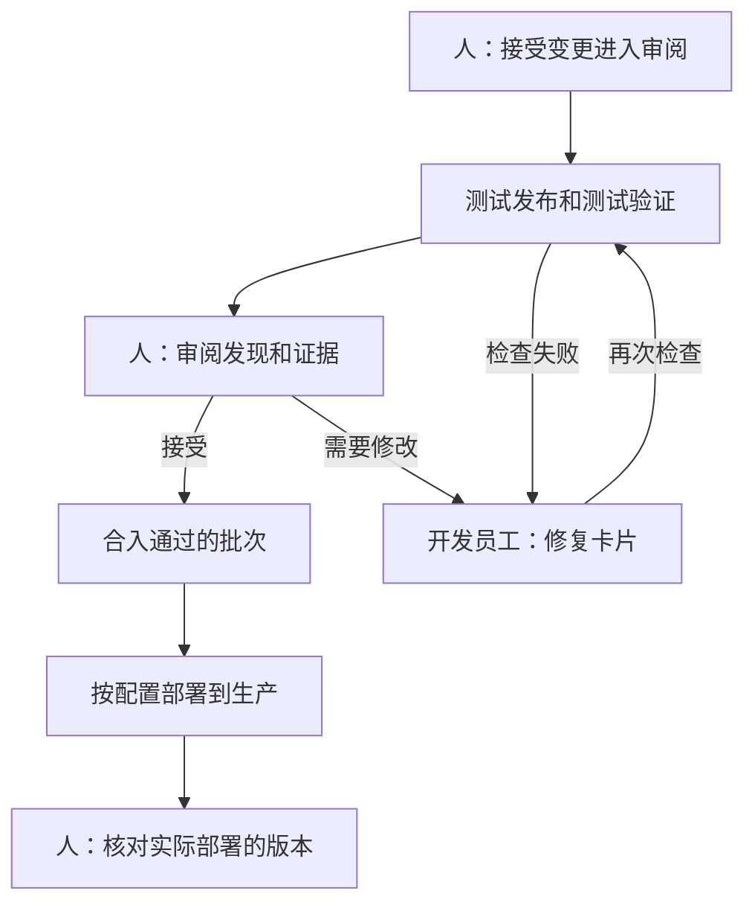

已发布的模板定义 Pull Request 或发布继续前需要产生哪些证据。根据要做的决定选择对应场景。检查失败或审阅要求修改时，卡片沿已配置的返工路径退回。生产部署是独立步骤，有自己的结果记录。

内置交付看板可以把这些记录带过测试发布、测试验证和生产发布。场景模板也可以只覆盖一个证据门禁，例如对照规格检查 PR，或评审候选版本。

测试发布和测试验证是看板泳道，不是一串独立的审阅产品。测试员工记录实际跑过的那个候选版本的结果。[Pull Request 自动化](/zh-cn/workflows/pull-request-automation/)也可以在轮询到匹配的 GitHub Pull Request 事件时启动 Job。这个 Job 做调查。它不合并；除非员工用自己的授权实际提交了审阅，它也不会批准 Pull Request。

关闭批次表示该批次完成了收尾。生产发布和资源回收另有记录。每个阶段要读什么，见[审阅与发布](/zh-cn/software-factory/review-release/)。哪条结果可以让卡片前进、怎样的豁免才有效，见[发布治理](/zh-cn/software-factory/release-governance/)。

## 选择证据模板

| 模板                                 | 阶段和产物                                                                                                    | 完成行为                                     |
| ------------------------------------ | ------------------------------------------------------------------------------------------------------------- | -------------------------------------------- |
| `pr-spec-adherence-check`            | 规格整理 → `acceptance_criteria`；逐条核验 → `adherence_report`                                               | 报告就绪后 `AUTO` 自动完成                   |
| `customer-escalation-to-product-fix` | 客服研判 → `reproduction`；开发修复 → `pull_request`；测试验证 → `verification`；客服回复草稿 → `reply_draft` | `HUMAN_REVIEW`，并配置一次退回开发的验证返工 |
| `release-candidate-readiness-review` | 发布取证 → `candidate_evidence`；就绪评审 → `readiness_report`                                                | `HUMAN_REVIEW`，交给负责人做发布决定         |

这些场景使用具名产物，不依赖一条自由格式的状态评论。接受下一阶段前，先从产物中读取受测版本、来源链接、失败用例和决定负责人。完整目录见[协作模板](/zh-cn/software-factory/templates/)。

## 你在哪些地方参与

- **决定泳道可以做什么。** 接上你希望看板调用的测试工作流和发布集成。泳道运行保存在该泳道上的执行器。
- **审阅证据。** 把 diff 和已确认的范围比较。对每条验收标准，阅读结果、受测提交或候选版本，以及环境。接受变更之前，先补上缺失的记录。
- **做出发布决定。** 接受需求，确认的是那一版需求。接受变更进入审阅是后来的决定。确认合并了什么、什么到达了生产，仍然是更后面的记录。员工会话结束，并不等于合并了 Pull Request。

测试失败时，带上失败的验收标准和证据退回卡片。开发员工修复这张卡片。第一次执行仍在进行时，不要再开一个修复会话。接管之后，记录你做了什么，并通过恢复操作交还。只恢复暂停，接管仍然有效。结束平台对 Pull Request 的跟进后，外部 Pull Request 仍然开着，卡片保持人工处理，直到你交还。

批次级的回应可以恢复每一张成员卡片。批准或重试共享工作之前，先看成员。

## 泳道员工

| 员工     | 在这条回路里的职责                                 |
| -------- | -------------------------------------------------- |
| 测试员工 | 在测试批次中记录候选版本的验证。                   |
| 开发员工 | 检查失败或你要求修改时，修复同一张卡片。           |
| 发布员工 | 执行项目集成实际支持的合并、等待、部署和验证步骤。 |

[业务验证](/zh-cn/software-factory/business-verification/)是变更与已确认验收标准的比较。[构建与测试](/zh-cn/software-factory/build-test/)是测试泳道的记录。[CI/CD 集成](/zh-cn/software-factory/cicd/)说明流水线如何成为这条记录。

## 如何配置

1. 选择与决定相符的已发布证据模板。[协作模板](/zh-cn/software-factory/templates/)列出阶段契约和完成规则。
2. 连接代码托管和仓库。准备所选阶段要运行的[环境](/zh-cn/software-factory/environments/)和测试工具。看板向导见[配置软件工厂](/zh-cn/getting-started/first-software-factory/)。
3. 为必配阶段绑定就绪员工。为这些阶段要调用的仓库和流水线资源授权。
4. 打开开发阶段已经记录代码引用的卡片，或用候选版本证据开始第一个阶段。阅读交付工作台、流水线运行、每个具名产物和卡片上等待回答的问题。

## 下一步

反馈或事件应成为下一项工作时，继续[信号到卡片](/zh-cn/software-factory/signal-to-card/)。这条回路留下的记录见[证据与追踪](/zh-cn/software-factory/evidence/)。
