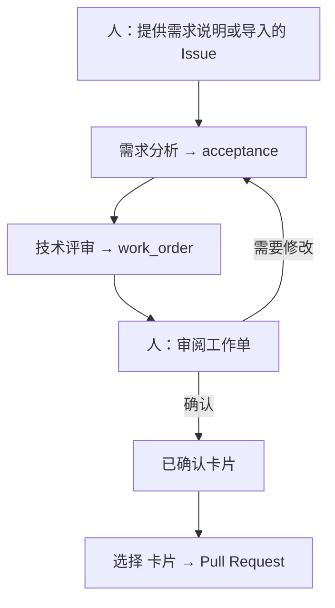

当工作来自需求说明、导入的 Issue 或一段粗略记录时，使用已发布的 `spec-intake-to-rfc-ticket-breakdown` 协作模板。模板会把请求整理成具名产物，让人在开发开始前审阅范围。

模板包含两个阶段。需求分析产出 `acceptance`，其中记录目标、范围、验收标准和待解决问题。技术评审读取这个产物，产出 `work_order`，其中记录实现约束、验证方法、风险和未决决定。模板以 `HUMAN_REVIEW` 结束，由人确认卡片已经可以进入开发。

## 模板交接契约

| 阶段     | 读取内容                          | 产出                                                  | 人需要做的决定           |
| -------- | --------------------------------- | ----------------------------------------------------- | ------------------------ |
| 需求分析 | 需求说明、Issue 或记录            | 包含目标、范围、标准和待解决问题的 `acceptance`       | 补充上下文并澄清预期结果 |
| 技术评审 | `acceptance` 和已授权的仓库上下文 | 包含实现范围、验证方法、风险和未决问题的 `work_order` | 确认工作可以进入开发     |

技术阶段通过模板的 `requires` 映射接收 `acceptance`。把仓库和环境限制写入卡片，让两个阶段使用相同边界。需求较大时拆成多张卡片，让每个部分分别接受范围确认。

## 配置模板

1. 打开**工作台 → 新建交付项目**，从已发布协作模板中选择 `spec-intake-to-rfc-ticket-breakdown`。
2. 为需求分析和技术评审绑定就绪员工。检查每个阶段的执行身份，只授予它需要的访问权限。
3. 在第一个阶段创建卡片，或把收件箱事项路由到项目。写入来源、预期结果、约束和仓库范围。
4. 阅读 `acceptance` 和 `work_order`，在卡片上回答待解决问题，并记录人工审阅决定。

验收标准或技术约束仍然含糊时，把卡片留在当前阶段。相关审阅和收件箱行为见[人工确认](/zh-cn/user-guide/human-approval/)与[工作进入](/zh-cn/software-factory/intake/)。

## 继续使用下一个模板

卡片确认后，选择[卡片 → Pull Request](/zh-cn/software-factory/card-to-pr/)，运行已发布的 `pr-author` 模板。如果请求来自反馈或故障，先阅读[信号 → 卡片](/zh-cn/software-factory/signal-to-card/)，在收集完成后选择场景。
