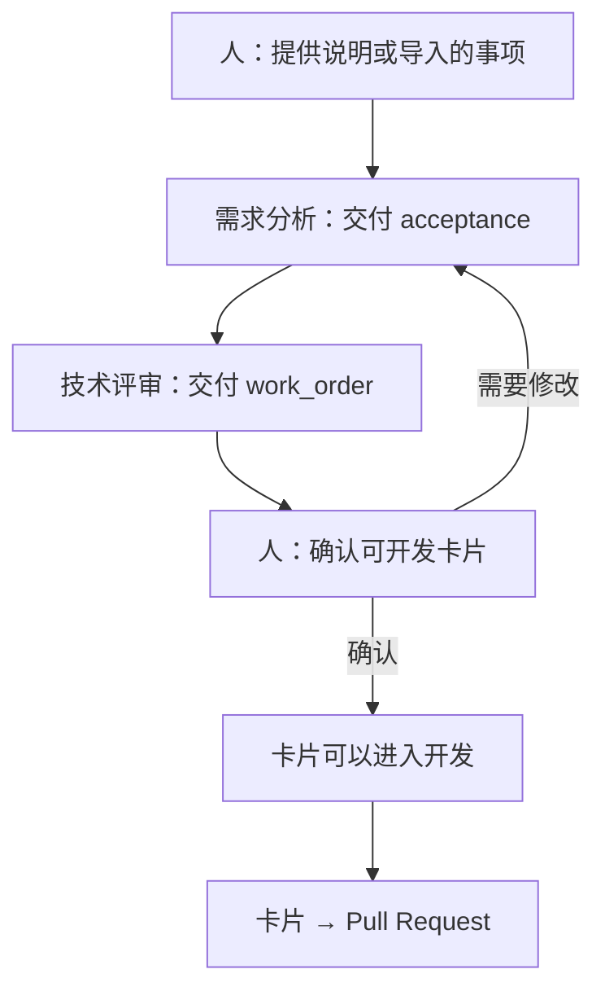

`spec-intake-to-rfc-ticket-breakdown` 模板把说明、导入的事项或笔记变成可开发卡片。第一个阶段「需求分析」交付 `acceptance` 产物，其中包含目标、范围、验收标准和未决问题。第二个阶段「技术评审」读取这个产物，交付包含实现约束、验证方法、风险和待决事项的 `work_order`。模板以 `HUMAN_REVIEW` 结束，因此开发开始前需要人确认工作单。

阶段名称和员工绑定来自已发布的模板版本。其他看板模板可以使用不同的阶段名称和完成规则。

大段说明要拆开时，分成多张卡片，每张卡片的验收标准都要能被审阅者检查。看板用批次组织后续的测试和发布。它不在卡片之间维护通用的依赖图。卡片应携带的设计怎么写，见[把技术设计连接到可执行工作](/zh-cn/learn/blueprints-work-orders/)。

## 你在哪些地方参与

- **定义结果。** 写明问题、成功标准、约束，以及范围之外的内容。这些标准的写法见[编写员工能够验证的需求](/zh-cn/learn/requirements-writing/)。
- **审阅草稿。** 范围由你决定。员工调研当前代码，并列出取舍和未决问题。会改变实现的问题，在交出卡片之前先解决。
- **确认卡片。** 确认告诉开发泳道：按写明的仓库和标准继续。合并、仓库凭据和流水线配置保持原样。

验收标准仍然含糊时，让卡片留在需求泳道。见[人工确认](/zh-cn/user-guide/human-approval/)和[工作进入](/zh-cn/software-factory/intake/)。

## 交接契约

| 阶段     | 输入                              | 输出                                                 |
| -------- | --------------------------------- | ---------------------------------------------------- |
| 需求分析 | 卡片说明、事项或笔记              | `acceptance`，包含目标、范围、验收标准和未决问题     |
| 技术评审 | `acceptance` 和已授权的仓库上下文 | `work_order`，包含实现范围、验证方法、风险和待决问题 |

技术阶段通过模板的 `requires` 映射接收第一个阶段的具名产物。把仓库和环境范围写在卡片上，让两个阶段使用同一个边界。

## 如何配置

1. 在**工作台 → 新建交付项目**选择已发布的 `spec-intake-to-rfc-ticket-breakdown` 模板。场景目录见[BoardFlow 看板模板](/zh-cn/software-factory/templates/)。
2. 连接代码托管。说明来自外部事项时，再连接事项来源。连接步骤见[配置软件工厂](/zh-cn/getting-started/first-software-factory/)。
3. 为「需求分析」和「技术评审」绑定就绪员工。核对两个阶段的**执行身份**，只授予各阶段应读取的仓库。
4. 从看板第一个阶段开始，或把收件箱事项转入项目。阅读两个交接产物，在卡片上回答未决问题，并完成人工确认。

## 下一步

用[卡片到 Pull Request](/zh-cn/software-factory/card-to-pr/)把已确认的卡片变成待审阅的变更。卡片已经足够具体时，可以直接从那里开始。
