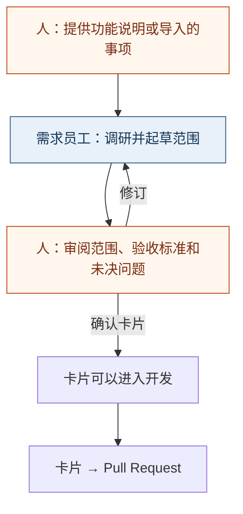

需求泳道把功能说明、导入的事项或一段粗略笔记变成团队可以接受的卡片。需求员工调研项目可以阅读的仓库，并起草范围、验收标准和未决问题。你审阅这份草稿。确认卡片之后，开发可以开始。卡片上的设计对话本身不会修改代码。

图中标出的是人。其余步骤由员工执行。

大段说明要拆开时，分成多张卡片，每张卡片的验收标准都要能被审阅者检查。看板用批次组织后续的测试和发布。它不在卡片之间维护通用的依赖图。卡片应携带的设计怎么写，见[把技术设计连接到可执行工作](/zh-cn/learn/blueprints-work-orders/)。

## 你在哪些地方参与

- **定义结果。** 写明问题、成功标准、约束，以及范围之外的内容。这些标准的写法见[编写员工能够验证的需求](/zh-cn/learn/requirements-writing/)。
- **审阅草稿。** 范围由你决定。员工调研当前代码，并列出取舍和未决问题。会改变实现的问题，在交出卡片之前先解决。
- **确认卡片。** 确认告诉开发泳道：按写明的仓库和标准继续。合并、仓库凭据和流水线配置保持原样。

验收标准仍然含糊时，让卡片留在需求泳道。见[人工确认](/zh-cn/user-guide/human-approval/)和[工作进入](/zh-cn/software-factory/intake/)。

## 泳道员工

| 员工     | 在这条回路里的职责                                                                       |
| -------- | ---------------------------------------------------------------------------------------- |
| 需求员工 | 调研，起草范围和标准，并等待确认。                                                       |
| 开发员工 | 你确认卡片之后实现它。交接见[卡片到 Pull Request](/zh-cn/software-factory/card-to-pr/)。 |

在看板向导或**泳道配置**里，把一名就绪员工指派到需求泳道。员工只需要对其应阅读的仓库授权。阅读授权不是推送授权。

## 如何配置

1. 连接代码托管。说明来自外部事项时，再连接事项来源。连接步骤见[配置软件工厂](/zh-cn/getting-started/first-software-factory/)。
2. 在需求泳道放一名就绪员工。核对这条泳道的**执行身份**。
3. 从看板上的**新建需求会话**开始，或把收件箱事项转入项目。
4. 阅读草稿，在卡片上回答未决问题，并确认范围、验收标准和允许的仓库。

## 下一步

用[卡片到 Pull Request](/zh-cn/software-factory/card-to-pr/)把已确认的卡片变成待审阅的变更。卡片已经足够具体时，可以直接从那里开始。
