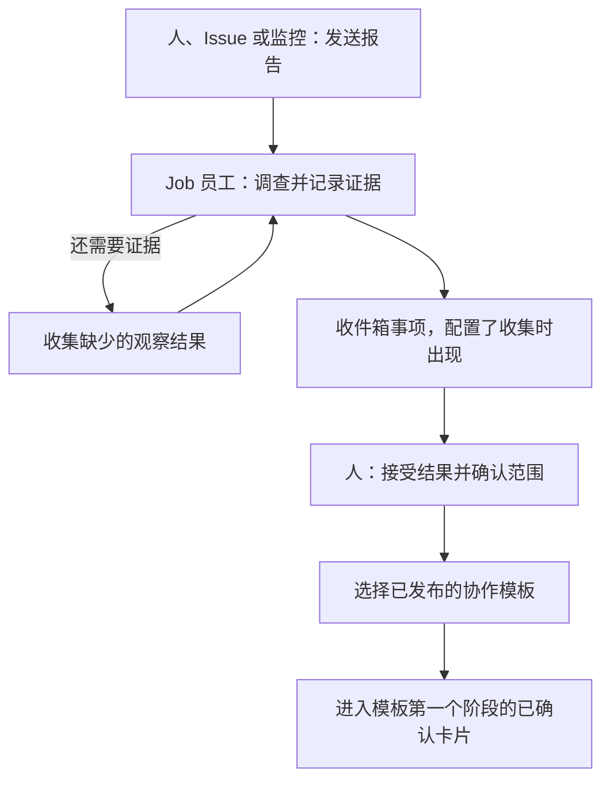

import MonitoringRoute from "../../../../components/MonitoringRoute.astro";

信号是一条可能需要交付工作的报告。它可以是导入的 Issue、启动 Job 的消息，或监控事件。第一步负责收集和调查报告，第二步为已确认卡片选择已发布的协作模板。

调查过程不会修改代码。只有在人接受调查结果、确认范围，并选择与工作相符的场景后，收件箱事项才会变成交付工作。



## 收集完成后选择模板

只有在人确认要完成什么工作以及现有证据之后，才选择场景。

| 已确认的结果                 | 协作模板                             | 第一个交接产物         |
| ---------------------------- | ------------------------------------ | ---------------------- |
| 客户报告需要修复、验证和回复 | `customer-escalation-to-product-fix` | `reproduction`         |
| 故障需要有来源的时间线和复盘 | `incident-investigator`              | `event_timeline`       |
| 支持问题暴露了文档缺口       | `docs-gap-from-support-ticket`       | `gap_analysis`         |
| 已确认 Issue 可以进入实现    | `pr-author`                          | `implementation_brief` |

收件箱事项仍然是来源记录。所选模板会通过自己的阶段和完成规则承载已确认卡片。完整场景目录见[协作模板](/zh-cn/software-factory/templates/)。

## 来源和收集

**Issue 和消息。**[Issue 自动化](/zh-cn/workflows/issue-automation/)可以轮询 Issue 事件或把任务导入收件箱。消息渠道可以在允许的发送者发消息时启动 Job。配置收集后，Job 可以使用稳定的来源身份保存收件箱事项。

**故障。**[Sentry](/zh-cn/integrations/sentry/)和[PagerDuty](/zh-cn/integrations/pagerduty/)可以在事件到达时启动已发布的 Job。运行记录会保留调查结果，直到人决定它是否应该成为卡片。[把反馈变成经过审阅的工作](/zh-cn/learn/feedback-review/)说明如何区分观察结果和假设。

## 生产告警示例

<MonitoringRoute />

## 人需要参与的地方

- **选择收集内容。**选择事件来源和调查结果的存放位置，并把原始报告附在收件箱事项上。
- **补充缺少的上下文。**补充预期行为、复现信息、影响范围和报告中没有的证据。
- **选择后续工作。**确认卡片的范围、仓库和环境边界，再选择负责后续阶段的协作模板。

报告无法调查时请求补充信息。没有后续工作时，写明原因后关闭或归档。无关问题保持为独立事项。

## 配置收集和模板

1. 连接产生信号的来源，例如代码托管、消息渠道、Sentry 或 PagerDuty。
2. 在负责调查信号的员工上创建并发布 Job。使用最窄的事件条件，启用前先预览样例。
3. 后续需要进入收件箱或工作台项目时，添加**收集任务 / 事项**。
4. 打开运行记录和收件箱事项，检查来源身份、调查结果和缺少的上下文。
5. 确认卡片并选择已发布的协作模板，为模板的必配阶段绑定就绪员工。

[运行、结果和恢复](/zh-cn/automate/runs-recovery/)说明收集运行失败、超时或被拒绝时如何处理。

## 信号研判模板

调查员工可以把这段填在 Job 的调查记录里。如果 Job 采集了收件箱事项，保留来源和运行回执，方便审阅者核对原始报告。

```text
来源与原话｜[来源编号或链接] [报告者看到了什么]
复现｜[环境、操作步骤、期望与实际表现]
证据｜[已观察到的事实或附件] [哪些仍是推测]
处理意见｜[跟进 / 补证 / 归档] [原因]
交接｜[采集时填写收件箱事项和运行回执] [接受并确认后的卡片]
```

**填写示例**　用户在 Issue #42 报告「筛选订单后导出，还是拿到了全部订单」。调查员工用三条样本订单复现了问题。页面只剩一行，CSV 却有三行数据。把样本 CSV 附在调查记录上。审阅者接受跟进，先澄清筛选结果为空时应导出什么，再确认卡片。

## 继续使用所选模板

请求仍需整理时继续阅读[需求 → 卡片](/zh-cn/software-factory/requirements-to-card/)。卡片已确认并准备实现时继续阅读[卡片 → Pull Request](/zh-cn/software-factory/card-to-pr/)。代码变更等待证据时继续阅读[Pull Request → 合并](/zh-cn/software-factory/pr-to-merge/)。
