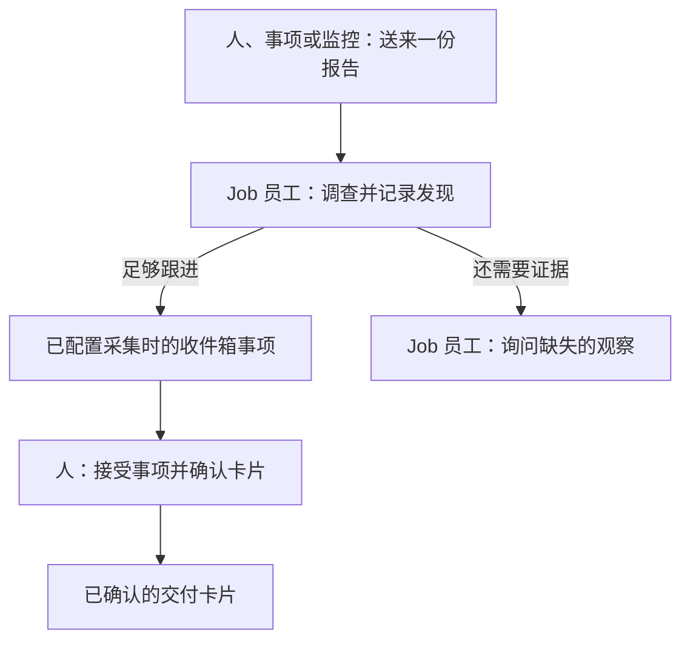

import MonitoringRoute from "../../../../components/MonitoringRoute.astro";

信号是可能值得做工程工作的报告：导入或轮询到的事项、启动 Job 的消息，或监控事件。Job 员工调查并写下发现。Job 上配置了**收集任务 / 事项**，并且运行记录了服务端回执时，可以保存一条收件箱事项。收件箱事项一直等待，直到人接受它并确认一张交付卡片。确认卡片之后，开发才被允许。调查本身不修改代码，创建收件箱事项也不会。

图中标出的是人。其余步骤由员工执行。

两类来源用的是这个形状。

**事项和消息。** [Issue 自动化](/zh-cn/workflows/issue-automation/)轮询 GitHub 事项事件，或把任务导入收件箱。消息渠道可以由允许的发送者启动 Job。员工可以摘要报告，并在配置了采集时记入收件箱。采集使用稳定的来源身份，因此同一来源不会被重复建档。匹配这个身份，就是本版本的重复处理。

**事件。** [Sentry](/zh-cn/integrations/sentry/)和 [PagerDuty](/zh-cn/integrations/pagerduty/)可以在事项或事件到达时启动已发布的 Job。运行里保存发现。Job 不更新外部事件，也不打开 Pull Request。代码修复仍然从已确认的卡片开始。

确认任何内容之前，如何把观察和假设分开，见[把反馈转成经过研判的工作](/zh-cn/learn/feedback-review/)。

## 线上告警示例

<MonitoringRoute />

## 你在哪些地方参与

- **选择采集什么。** 选定 GitHub 事件、导入来源、消息渠道或监控连接。选择收件箱或工作台项目作为采集目的地。
- **补上缺失的上下文。** 加上期望行为、复现步骤，以及报告里没有的证据。把员工的措辞当作待核对的发现，并保留原始报告。
- **授权实现。** 接受收件箱事项，记录的是这份报告值得跟进。确认卡片，并写明范围和仓库，这一步才让开发泳道继续。在那张卡片上要求具体修复。监控运行不会授权生产变更。

报告无法调查时，请求补充信息。不需要后续工作时，记下原因并关闭或归档。把互不相关的问题保持为独立事项。

## 泳道员工

| 员工     | 在这条回路里的职责                                                                              |
| -------- | ----------------------------------------------------------------------------------------------- |
| Job 员工 | 调查信号，询问缺失的证据，并在 Job 开启采集时记入收件箱。                                       |
| 需求员工 | 澄清仍然宽到无法实现的后续工作。见[需求到卡片](/zh-cn/software-factory/requirements-to-card/)。 |
| 开发员工 | 你确认卡片之后实现它。见[卡片到 Pull Request](/zh-cn/software-factory/card-to-pr/)。            |

Job 员工不需要推送权限。开发员工需要，而且只在卡片存在之后。

## 如何配置

1. 连接信号的来源：事项用[代码托管](/zh-cn/integrations/code-repositories/)，消息用[消息渠道](/zh-cn/integrations/overview/)，监控用 [Sentry](/zh-cn/integrations/sentry/)或 [PagerDuty](/zh-cn/integrations/pagerduty/)。负责调查的员工需要访问它应阅读的仓库和证据。
2. 在该员工上创建 Job。加上事件，以及应该唤醒它的最窄条件。新规则默认关闭。预览一条样本。预览检查匹配，不创建运行。
3. 发布 Job。手动运行看起来正确之后再启用规则。第一次成功的 GitHub 读取会建立基线，不会重放历史。
4. 要记入收件箱，添加**收集任务 / 事项**，并选择收件箱或工作台项目。采集界面使用 Claude Code 运行时。聊天里的一句话不是已保存的事项。空采集仍然会记录什么都没匹配到。
5. 打开运行和收件箱事项。阅读发现、来源身份和下一步。把可以开发的事项转入看板并确认卡片。

失败、超时或被拒绝的运行见[运行、结果与恢复](/zh-cn/automate/runs-recovery/)。暂停的来源不会接收等待中的事件。重新打开会开始一条新基线。

## 下一步

已确认的卡片继续[卡片到 Pull Request](/zh-cn/software-factory/card-to-pr/)。更宽的请求去[需求到卡片](/zh-cn/software-factory/requirements-to-card/)。代码修复在发布之前仍然经过 [Pull Request 到合并](/zh-cn/software-factory/pr-to-merge/)。
